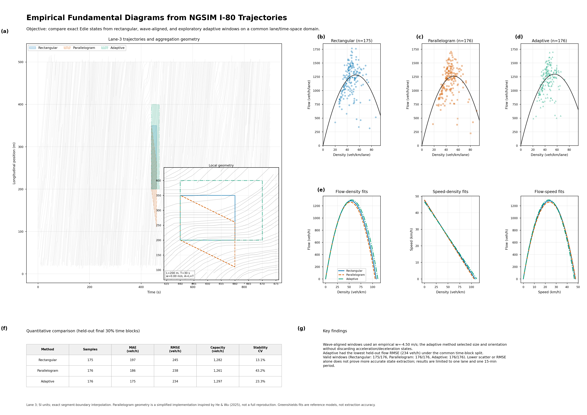

# Week 04：NGSIM I-80 单车道经验基本图

本目录完成了从 NGSIM I-80 连续车辆轨迹出发，使用 Edie 广义定义构建和比较三类经验
交通流基本图的完整实验。全部图表和指标均由真实 CSV 数据运行生成。

## 最终报告



- [一页式 A3 PDF 报告](NGSIM_FD_Analysis/results/figures/NGSIM_I80_Fundamental_Diagram_Report.pdf)
- [高清 PNG 报告](NGSIM_FD_Analysis/results/figures/NGSIM_I80_Fundamental_Diagram_Report.png)
- [中文逐面板讲解 TXT](NGSIM_FD_Analysis/results/figures/NGSIM_I80_Fundamental_Diagram_Report_讲解.txt)
- [完整可复现项目压缩包](NGSIM_FD_Analysis.zip)

## 研究范围

| 项目 | 本次设置 |
|---|---|
| 数据集 | NGSIM I-80，2005-04-13 16:00–16:15 |
| 行驶方向 | 数据集中同一主线方向 |
| 目标车道 | Lane 3，可通过命令行切换 |
| 纵向坐标 | 道路公共坐标，不按车辆单独归零 |
| 单位 | m、s、m/s、m/s²；输出为 veh/h/lane、veh/km/lane、km/h |
| 空间窗口 | 100、150、200 m |
| 时间窗口 | 10、20、30 s |
| 采样敏感性 | 0.1、0.2、0.5 s |

目录内只有一个 NGSIM I-80 道路数据源，因此不存在需要人工选择的多条候选道路。

## 三种聚合方法

1. **Rectangular baseline**：固定矩形时空窗口。
2. **Parallelogram baseline**：按估计交通波速度倾斜的平行四边形窗口；本次
   (w=-4.5) m/s。该实现受 He 与 Wu（2025）启发，但不是原论文算法的完整复现。
3. **Adaptive exploratory method**：在不同长度、时长和方向的候选窗口中，根据速度
   变异、前后半段速度变化、平均加速度、空间异质性、车辆数和覆盖率选择窗口。

三种方法都把轨迹视为分段线性曲线，精确计算轨迹与窗口多边形的交点、窗口内行驶距离
和停留时间，没有使用简单的离散点计数。

## 数据清洗结果

| 检查项 | 结果 |
|---|---:|
| 原始记录数 | 1,226,650 |
| 必需字段缺失 | 0 |
| 完全重复记录 | 0 |
| 异常纵向位置跳跃 | 删除 7 行 |
| 单点连续片段 | 删除 1 行 |
| Lane 3 清洗后记录 | 193,437 |
| 保留车辆 | 421 |
| 连续轨迹片段 | 436 |
| 平滑 | 默认关闭 |

更详细的字段检查见 [数据清洗报告](analysis/ngsim_i80_cleaning_report.md) 和
[预处理 JSON 摘要](NGSIM_FD_Analysis/results/processed/preprocessing_summary.json)。
原始数据没有被修改。

## 主要结果

评估采用时间块划分：前 70% 作为训练集，最后 30% 作为测试集。

| 方法 | 有效样本 | 测试 MAE (veh/h) | 测试 RMSE (veh/h) | 容量 (veh/h/lane) | 容量稳定性 CV |
|---|---:|---:|---:|---:|---:|
| Rectangular | 175 | 197.45 | 244.90 | 1282.49 | 13.09% |
| Parallelogram | 176 | 186.19 | 237.94 | 1260.92 | 43.19% |
| Adaptive | 176 | 175.08 | 233.67 | 1297.19 | 23.31% |

- Adaptive 在本次测试集上的 MAE 和 RMSE 最低。
- Rectangular 的时间块容量稳定性最好。
- Adaptive 只有 27 个拥堵分支样本，而两个基线各有 38 个，因此不能把散点更集中或
  RMSE 更低直接解释为交通状态提取全面更准确。
- 全部有效状态满足 (q=kv)，最大相对误差为 (4.27\times10^{-16})。
- 100/150/200 m、10/20/30 s 参数扫描和 0.1/0.2/0.5 s 采样敏感性结果均已保存。

完整指标见：

- [评价指标](NGSIM_FD_Analysis/results/metrics/evaluation_metrics.csv)
- [参数敏感性](NGSIM_FD_Analysis/results/metrics/parameter_sensitivity.csv)
- [采样敏感性](NGSIM_FD_Analysis/results/metrics/sampling_sensitivity.csv)
- [自适应状态分类](NGSIM_FD_Analysis/results/metrics/adaptive_state_class_summary.csv)

## 每种方法的三类基本图

- [Rectangular：流量–密度、速度–密度、流量–速度](NGSIM_FD_Analysis/results/figures/Rectangular_Fundamental_Diagrams.png)
- [Parallelogram：流量–密度、速度–密度、流量–速度](NGSIM_FD_Analysis/results/figures/Parallelogram_Fundamental_Diagrams.png)
- [Adaptive：流量–密度、速度–密度、流量–速度](NGSIM_FD_Analysis/results/figures/Adaptive_Fundamental_Diagrams.png)

## 目录结构

```text
week04/
├── datasets/
│   └── NGSIM-I80/
│       └── NGSIM_I80_20050413_1600-1615_SI.csv
├── analysis/
│   ├── clean_ngsim_i80.py
│   └── ngsim_i80_cleaning_report.md
├── NGSIM_FD_Analysis/
│   ├── main.py
│   ├── config.yaml
│   ├── requirements.txt
│   ├── README.md
│   ├── src/
│   ├── tests/
│   └── results/
├── NGSIM_FD_Analysis.zip
└── README.md
```

## 复现方法

Python 版本：3.11。

```powershell
cd NGSIM_FD_Analysis
python -m pip install -r requirements.txt
python -m unittest discover -s tests -v
python main.py --input ../datasets/NGSIM-I80/NGSIM_I80_20050413_1600-1615_SI.csv --lane 3
```

所有窗口参数、异常阈值、波速候选、Adaptive 得分权重、训练测试划分和输出分辨率都集中在
[config.yaml](NGSIM_FD_Analysis/config.yaml)。项目内部的
[英文技术 README](NGSIM_FD_Analysis/README.md) 提供字段映射、算法细节和完整输出清单。

## 质量验证

- Edie 计算、边界插值、平行四边形物理闭合和换道片段拆分共 4 项单元测试，全部通过。
- 最终 PDF 为单页 A3 横向页面。
- 报告 PNG 为 4962×3507、RGB、300 DPI。
- 三种方法的独立诊断图均为 3600×1110、RGB、300 DPI。
- 最终 ZIP 已通过 CRC 和必需文件清单检查。

## 局限性

- 结果只代表 Lane 3 的一个 15 分钟采集时段。
- 波速来自拥堵速度场的滞后相关估计，并非唯一的物理波速。
- Adaptive 稳定性评分是待验证的研究假设，可能引入选择偏差。
- Greenshields 仅作为经典参考模型；其拟合误差不是交通状态提取准确性的直接证明。
- 默认关闭平滑，保留了真实急减速和拥堵波，但 NGSIM 原始测量误差仍可能影响结果。

## 参考文献

- Edie, L. C. (1965). Discussion of traffic stream measurements and definitions.
- He, Z., & Wu, C. (2025). *Constructing the fundamental diagrams of traffic flow from
  large-scale vehicle trajectory data*. arXiv:2507.09648v2.
- Kassis, T., et al. (2026). *Scientific Agent Skills: A Library of Procedural Knowledge
  for Research Agents*. arXiv:2609.00065.

