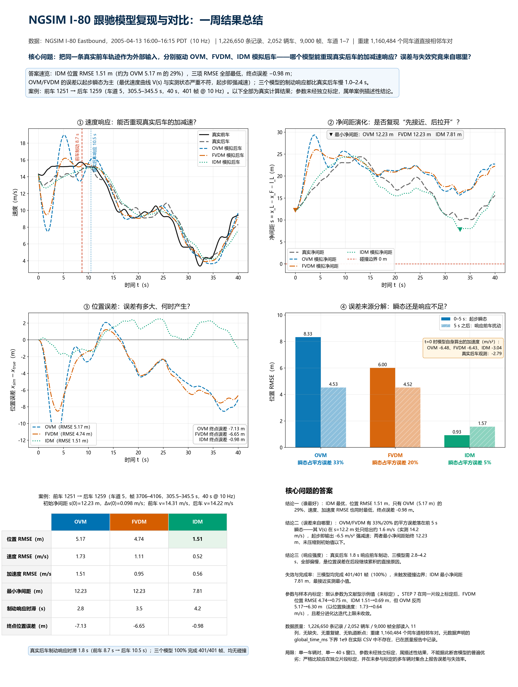

# Week 05 — NGSIM I-80 跟驰模型复现与对比（OVM / FVDM / IDM）

用同一段真实前车轨迹分别驱动三种经典跟驰模型，考察它们重现真实后车动力学的能力、误差来源与失效机制。
全部数字来自本仓库中真实运行、可复现的计算结果，没有任何编造曲线或指标。

**一图总览：[results_summary.png](results_summary.png)（矢量版 [results_summary.pdf](results_summary.pdf)）**



---

## 1. 核心问题与结论

**核心问题：** 把同一条真实前车轨迹作为外部输入分别驱动 OVM、FVDM、IDM 模拟后车——哪个模型能重现真实后车的加减速响应？误差与失效来自哪里？

| 结论 | 依据（本仓库真实计算） |
|---|---|
| **① 谁最好：IDM > FVDM > OVM** | IDM 位置 RMSE **1.51 m**，只有 OVM（5.17 m）的 **29%**；速度、加速度 RMSE 同时最低；终点位置误差仅 −0.98 m（OVM −7.13 m / FVDM −6.65 m） |
| **② 误差来自起步瞬态** | OVM / FVDM 有 **33% / 20%** 的位置平方误差落在前 5 s：其最优速度曲线 V(s) 在 s=12.2 m 处只给出约 1.6 m/s，而实测为 14.2 m/s，于是起步即输出 −6.5 m/s² 的强减速；两者最小净间距始终 12.23 m，**从未压缩到初始值以下**，即没有复现真实后车“先接近、后拉开”的过程 |
| **③ 响应强度普遍不足** | 真实后车在前车制动后 **1.8 s** 响应；三模型需要 **2.8 / 3.5 / 4.2 s**，全部偏慢，这是位置误差在后段继续累积的直接原因 |
| **④ 无模型失效，但精度差异显著** | 三次仿真均 100% 完成 401/401 帧，均未触发碰撞边界；IDM 最小净间距 7.81 m，是三者中最接近实测最小值 9.97 m 的 |

> 以上是**单车辆对、单一 40 s 窗口、参数未经独立标定**的描述性结论，不能据此断言模型的普遍优劣。

---

## 2. 数据与质量核查

| 项目 | 数值 |
|---|---|
| 数据集 | NGSIM I-80 Eastbound，2005-04-13 16:00–16:15 PDT，10 Hz |
| 记录 / 车辆 / 帧 | 1,226,650 条 / 2,052 辆 / 9,000 帧（车道 1–7，时长 0–899.9 s） |
| 读入列数 | 11 列全部读入并按真实名称校验（`vehicle_id` … `lane_id`），SI 单位不再二次换算 |
| 缺失值 / 重复 vehicle-frame 键 / 轨道断点 | 0 / 0 / 0 |
| 越界异常（负速度、非正车长、超限加速度等） | 0 条（阈值：速度 ≤ 60 m/s，|a| ≤ 15 m/s²） |
| 采样网格与时间戳一致性 | 0 条偏离 0.1 s 网格；帧号、`time_s`、`global_time_ms` 三者对齐 0 处不一致 |
| 元数据核查结论 | `source_and_checks.json` 声明 `global_time_ms` 下界为 `1000000000`，但**实际 CSV 中不存在该值**（真实范围 1113433200000–1113434099900）；其余记录数、字节数、sha256 全部一致 |

详见 [dataset_summary.json](NGSIM_CarFollowing/outputs/01_data_quality/dataset_summary.json) 与 [data/README.md](NGSIM_CarFollowing/data/README.md)。

## 3. 跟驰关系重建与案例筛选

1. 先对**全部车型**按 `frame_id + lane_id` 分组、按 `local_y_m` 排序，取紧邻两车作为候选前后车（在建立关系前筛 `vehicle_class=2` 会漏掉夹在中间的其它车型，因此被显式禁止）。
2. 净间距严格按 `s = x_L − x_F − l_L`（前车长度）计算，而不是前端到前端距离。
3. 得到 **1,160,484** 个有效相邻车对（其中前后车均为小客车 1,056,829 个）、**3,163** 段连续跟驰、**17,759** 个候选窗口（14,712 个合格），按完整度、速度扰动幅度、前车最大减速度、后车响应可观察性、间距质量综合打分后输出前 100 名。

**选定案例：** 前车 **1251** → 后车 **1259**，车道 **5**，帧 **3706–4106**，**305.5–345.5 s**（40.0 s，401 帧 @ 10 Hz，候选排名第 16）。

| 初始状态（三模型共用的初始化量） | Leader 1251 | Follower 1259 |
|---|---|---|
| 初始纵向位置（m） | 85.8534 | 68.9565 |
| 初始速度（m/s） | 14.3150 | 14.2167 |
| 初始加速度（m/s²） | −0.4512 | −2.7874 |
| 车长（m） / 车道 | 4.6634 / 5 | 5.5779 / 5 |

初始净间距 **s(0) = 12.2334 m**，Δv(0) = 0.0982 m/s，Δa(0) = 2.3362 m/s²。
真实后车初始加速度**只作为观测值**；OVM/FVDM/IDM 的初始加速度由各自方程算出（−6.48 / −6.43 / −3.04 m/s²）。
平滑前（原始观测）的速度与加速度同时保留在 `raw_*` / `source_frame_*` 字段中，便于追溯。

## 4. 评价结果

| Model | 位置 RMSE (m) | 速度 RMSE (m/s) | 加速度 RMSE (m/s²) | 最小净间距 (m) | 制动响应时滞 (s) | 终点位置误差 (m) | 完成率 | 碰撞 |
|---|---|---|---|---|---|---|---|---|
| OVM | 5.17 | 1.73 | 1.51 | 12.23 | 2.8 | −7.13 | 100 % | 无 |
| FVDM | 4.74 | 1.11 | 0.95 | 12.23 | 3.5 | −6.65 | 100 % | 无 |
| **IDM** | **1.51** | **0.52** | **0.56** | **7.81** | 4.2 | **−0.98** | 100 % | 无 |
| *真实后车* | — | — | — | *9.97* | *1.8* | — | — | — |

模型公式与参数（`config.yaml` 中显式记录，未经独立标定，故不称为最优参数）：

- **OVM**：`a_F = κ[V(s) − v_F]`，`κ=0.5, v_max=33.33, s_c=25.0, ℓ=8.0`
- **FVDM**：`a_F = κ[V(s) − v_F] + λ(v_L − v_F)`，`κ=0.5, λ=0.5`，与 OVM 共用同一 V(s)
- **IDM**：`a_F = a[1 − (v_F/v_0)^δ − (s*/s)²]`，`v_0=33.33, T=1.5, s_0=2.0, a=1.2, b=2.0, δ=4`
- 数值积分：Δt = 0.1 s，`v_{k+1}=max(0, v_k+a_kΔt)`，`x_{k+1}=x_k+½(v_k+v_{k+1})Δt`，`s_{k+1}=x^{true}_{L,k+1}−x^{sim}_{F,k+1}−l_L`；三种模型共用同一积分器与同一真实前车轨迹，仿真中**不使用真实后车状态纠偏**。

完整报告（含误差来源分解、失效分析与研究局限）：[experiment_report.md](NGSIM_CarFollowing/outputs/06_evaluation/experiment_report.md)。

## 5. 可选扩展：样本内参数标定（STEP 7）

STEP 7 使用 `scipy.optimize.differential_evolution`，目标函数为位置/速度归一化误差的加权组合并加入失效、碰撞、缺失惩罚。

| Model | 目标函数（标定前→后） | 位置 RMSE（前→后，m） | 速度 RMSE（前→后，m/s） |
|---|---|---|---|
| OVM | 0.1111 → 0.0426 | 5.17 → **6.30（变差）** | 1.73 → 0.64 |
| FVDM | 0.0715 → 0.0249 | 4.74 → **0.75** | 1.11 → 0.39 |
| IDM | 0.0333 → 0.0262 | 1.51 → **0.69** | 0.52 → 0.41 |

要点：标定显著改善了 FVDM/IDM，但 OVM 是**以位置精度换速度精度**（权重 0.5/0.5 的必然结果）；三次差分进化都达到 `maxiter: 40` 上限未收敛（`optimizer_success=false`），因此这些参数只能视为演示结果。产物中明确标注 `in_sample=true / generalization_result=false`。

## 6. 目录结构与文件清单

```text
week05/
├── README.md                      # 本文件（总览与结论）
├── results_summary.png / .pdf     # 一页图文总结（本 README 顶部图片）
├── make_summary_figure.py         # 生成该总结图的脚本（从 outputs 读数据，可复现）
├── datasets/
│   ├── NGSIM-I80/                 # 输入数据（只读）
│   │   ├── NGSIM_I80_20050413_1600-1615_SI.csv   99.3 MB，sha256 df86a98e…695255
│   │   ├── source_and_checks.json
│   │   └── 使用说明.txt
│   └── 第4周_NGSIM-I80_课堂数据.zip  # 与上述内容相同的数据包
└── NGSIM_CarFollowing/            # 可复现实验项目
    ├── config.yaml                # 全部阈值、模型参数、标定配置
    ├── run_pipeline.py            # 统一入口（STEP 0–6，--start-step 7 可选标定）
    ├── requirements.txt           # 固定为本机验证过的版本
    ├── README.md                  # 项目级操作手册
    ├── data/README.md             # 数据放置说明
    ├── src/                       # 00_inspect_data … 07_calibrate（模块化，逐步独立可运行）
    ├── tests/                     # 75 个测试（单元 + 独立复算校验）
    └── outputs/                   # 中间结果与最终产物（见下）
```

关键产物（全部为真实计算结果）：

| 产物 | 说明 |
|---|---|
| [dataset_summary.json](NGSIM_CarFollowing/outputs/01_data_quality/dataset_summary.json) | 数据质量与异常核查报告 |
| [frame_pairs.csv](NGSIM_CarFollowing/outputs/02_following_pairs/frame_pairs.csv) | 每帧同车道直接相邻车对（198 MB） |
| [candidate_cases.csv](NGSIM_CarFollowing/outputs/03_cases/candidate_cases.csv) · [selected_case.json](NGSIM_CarFollowing/outputs/03_cases/selected_case.json) | 候选排序表与选定案例 |
| [initial_conditions.json](NGSIM_CarFollowing/outputs/04_prepared/initial_conditions.json) · [trajectory_clean.csv](NGSIM_CarFollowing/outputs/04_prepared/trajectory_clean.csv) | 两车初始状态与清洗后真值轨迹 |
| [simulation_OVM.csv](NGSIM_CarFollowing/outputs/05_simulation/simulation_OVM.csv)（另有 FVDM / IDM） · [simulation_status.json](NGSIM_CarFollowing/outputs/05_simulation/simulation_status.json) | 三模型逐时刻仿真与状态元数据 |
| [evaluation_metrics.csv](NGSIM_CarFollowing/outputs/06_evaluation/evaluation_metrics.csv) · [model_comparison.png](NGSIM_CarFollowing/outputs/06_evaluation/model_comparison.png) · [experiment_report.md](NGSIM_CarFollowing/outputs/06_evaluation/experiment_report.md) | 指标、六类图 + 综合图、实验报告 |
| [calibrated_parameters.json](NGSIM_CarFollowing/outputs/07_calibration/calibrated_parameters.json) · [calibration_metrics.csv](NGSIM_CarFollowing/outputs/07_calibration/calibration_metrics.csv) | 可选标定的参数与指标 |

## 7. 如何运行

```powershell
cd NGSIM_CarFollowing
python -m pip install -r requirements.txt      # 已验证：Python 3.11.4

python run_pipeline.py                         # STEP 0–6 全流程（约 1 分钟）
python run_pipeline.py --start-step 3 --end-step 6
python run_pipeline.py --start-step 7 --end-step 7   # 可选：样本内参数标定（约 8 分钟）
python -m pytest -q                            # 75 个测试
```

重新生成一页总结图（从 `outputs/` 读取真实数据，标题、结论与数值都会同步更新）：

```powershell
cd ..
python make_summary_figure.py                  # 输出 results_summary.png / .pdf
```

更换跟驰车辆对、修改模型参数、查看图表的方式见 [NGSIM_CarFollowing/README.md](NGSIM_CarFollowing/README.md)；
输入数据放置见 [data/README.md](NGSIM_CarFollowing/data/README.md)。

## 8. 可复现性与验证

- **确定性**：连续两次完整运行后，所有 CSV 与 PNG **逐字节一致**；只有含时间戳的文件（JSON 元数据、PDF 的 CreationDate、报告生成时间行）不同。
- **独立复算**：`tests/test_artifact_consistency.py` 不导入项目模型代码，而是独立重写三个模型的公式与积分器，回放仿真轨迹并与落盘的 CSV 对比，同时复算 RMSE、最小净间距、终点误差与报告中的分段误差。
- **溯源**：`simulation_status.json` 与 `calibrated_parameters.json` 记录所依赖 `trajectory_clean.csv` 的 sha256，测试会校验其与当前文件一致。
- **本轮的修复**：① 修好了超大 CSV 原子替换在 Windows 上偶发的 `WinError 5` 导致整轮重跑中断的问题（重试 + 兜底写入，并有测试覆盖）；② 修好了初始化状态不一致——报告表格曾用原始观测值（隐含 12.096 m 间距）而仿真与真值使用平滑后状态（12.2334 m），现在 `initial_*` 统一为**仿真实际使用的状态**，原始观测保留在 `raw_*`/`source_frame_*`，并由 STEP 3 的 8 项一致性检查强制校验。

## 9. 局限与未完成项（如实说明）

1. 结论基于**单一车辆对、单一 40 s 窗口**，不能推广到其他驾驶人、车道或交通状态。
2. 默认参数为文献型示例值；STEP 7 的标定与评价使用**同一片段**，属样本内演示，不构成泛化性能；且差分进化未收敛。
3. **未实现**多车辆对批量仿真与“独立片段标定 + 留出片段检验”的严格流程（属建议性扩展）。
4. 本机数据包内**不存在**原始英制 `*_raw.csv`，项目未引用任何 raw 输入；如需英制原始数据需另行下载。
5. 碰撞判据为一维净间距边界，不含横向重叠、车辆姿态与感知反应误差。
6. NGSIM 轨迹本身含测量噪声，位置平滑（Savitzky–Golay，窗口 21、2 阶）会改变高频成分，响应时滞也随阈值与连续帧规则变化。
