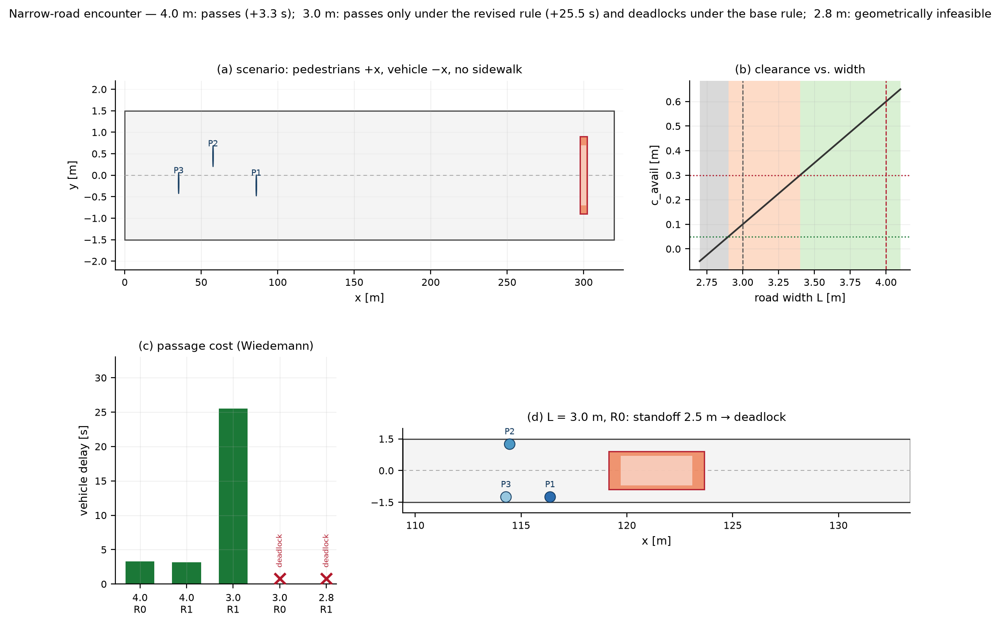
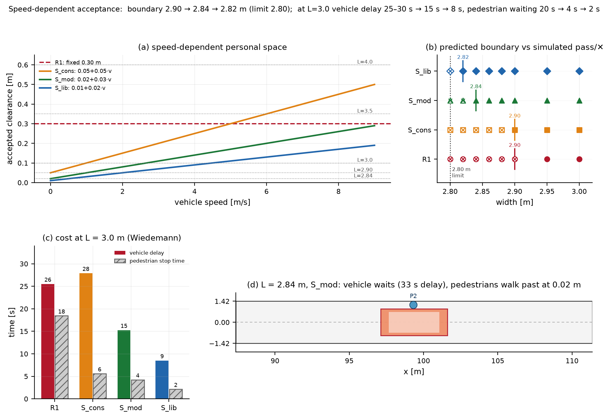

# Week 06 — 窄路相遇：统一人-车模型的规则设计与失效分析（Wiedemann / 社会力）

同一条无路口、无信号灯、无人行道的窄路上，少量行人沿 +x 步行，一辆汽车从右侧沿 −x 迎面驶来；行人可侧移，汽车只能减速/停车。实验用**同一个 Agent 框架**表征行人与车辆（参数不同），比较两种运动模型（社会力 SFM、Wiedemann 阈值模型）与两套交互规则（R0 基准、R1 修改），回答"道路多宽还能过、过不去是空间不够还是规则不合理"。

> **全部结果已整理为“一张图 + 一个文档”：**
> **[results_all.png](results_all.png)（矢量版 [results_all.pdf](results_all.pdf)）** ·
> **[RESULTS.md](RESULTS.md)**（场景、两组实验的设计/规则/全部结果表、失败判断、模型消解、复现与局限）

本目录包含**两个递进实验**：

| | 实验 1：固定个人空间 | 实验 2：速度相关的个人空间 |
|---|---|---|
| 行人模型 | 横向余量 ≥ 0.30 m 才继续走 | 接受关系 c_acc(v) = c0 + k·v；慢车时愿意贴近穿行，不接受时速度可降到 0 |
| 可通行边界 | 2.90 m（R1）/ 3.40 m（R0） | **2.82 m（S_lib）/ 2.84 m（S_mod）**，逼近 2.80 m 几何极限 |
| 3.0 m 车辆延误 | 25.5–29.8 s（R1） | **15.3 s（S_mod）/ 8.5 s（S_lib）** |
| 3.0 m 行人停车总时长 | 18.5–21.2 s | **4.3 s（S_mod）/ 2.2 s（S_lib）** |
| 报告 | [实验报告.md](narrow_road/report/实验报告.md) | [实验2_速度相关接受模型.md](narrow_road/report/实验2_速度相关接受模型.md) |

**一页总览（实验 1）：[summary.png](narrow_road/outputs/figures/summary.png)**；**（实验 2）：[summary2.png](narrow_road/outputs_acceptance/figures/summary2.png)**





详细报告：[实验 1](narrow_road/report/实验报告.md)、[实验 2](narrow_road/report/实验2_速度相关接受模型.md)；项目手册：[narrow_road/README.md](narrow_road/README.md)。

---

## 1. 核心问题与结论

**核心问题：** 只改变道路宽度 L，人车双方都按同一套规则/模型行动，什么时候能通过、什么时候僵持？僵持是**空间不足**还是**规则失效**？改规则能否解决？

| 结论 | 依据（本仓库真实计算） |
|---|---|
| **① 4.0 m 宽路几乎无冲突** | 车辆延误仅 **1.4–3.3 s**，车速最低 4.8–6.1 m/s，通过时身体余量 **0.60 m**，行人前进只损失 0.25–0.27 s，无停车、无接触 |
| **② 3.0 m 窄路在基准规则 R0 下僵持** | 车辆 t=22.4 s 停住，三名行人先后到达并停在车头两侧；车头距最近行人 2.53 m，直到 t=90.3 s 判定僵持。**全过程无身体重叠、无紧急制动**（最大减速度 2.50 m/s² = 舒适值） |
| **③ 3.0 m 的僵持是"规则失效"，不是空间不足** | 几何余量 **0.10 m** > 几何下限 0.05 m；改成速度相关余量（R1）后同一几何下以约 **1 m/s 蹭行通过**，代价是车辆延误 **25.5–29.8 s**、三名行人各等待约 9–10 s，最近身体余量仍为 0.10 m |
| **④ 2.8 m 才是真正的空间不足** | 行人贴到路缘时与车身恰好相切（c=0），任何规则都无法通过：R0 与 R1 都僵持；R1 的允许速度 (c−0.05)/0.05 也为 0 |
| **⑤ 两条边界可解析预测** | c_avail(L)=L/2−1.40；R0 可通行 ⇔ L ≥ 2·(0.30+0.90+0.50) = **3.40 m**；R1 ⇔ L > 2·(0.05+0.90+0.50) = **2.90 m**。16 个（宽度×规则）格子的预测与仿真结果 **16/16 一致** |
| **⑥ 失败可归因到具体条款** | 单因素消融（L=3.0 m）：只改车辆规则 A1 → **通过**（29.8 s）；只改行人规则 A2 → **仍僵持**。起决定作用的是车辆"固定 0.30 m 余量"条款；行人"等待时僵住"在本参数下没有成为瓶颈 |
| **⑦ 两种运动模型结论一致** | SFM 与 Wiedemann 在全部 16 个格子里通过/僵持结论相同；定量延误差 ≤ 约 15%（宽路 Wiedemann 慢 1.0–1.6 s，3.0 m 蹭行时反而快 4.3 s） |

> 以上为**单一固定初始条件（1 车 3 人、固定种子）、参数未经真实数据标定**的受控仿真结论；改变车辆横向位置策略、行人行为参数或人群规模可能移动这些边界，不应直接外推到真实道路设计。

---

## 2. 实验设计

### 2.1 场景与运动设定

- 笛卡尔坐标（m, s）：x 沿路，y 横向，路中线 y=0；道路 x ∈ [0, 320] m。
- 3 名行人：x ∈ [10, 90] m、y ∈ [−0.5, 0.5] m，步速 0.9–1.5 m/s，沿 +x 走；可侧移（≤1.0 m/s），不后退。
- 汽车：从 x=300 m 出现，沿 −x 驶来，期望速度 9.0 m/s；**固定在中线 y=0，只能减速/停车**。
- 主体尺寸：行人肩宽 0.5 m（外接圆 r=0.25 m），车辆 4.5 × 1.8 m。
- 初始条件由固定种子一次抽取后冻结，所有宽度/规则/模型共用。
- 每个时间步：决策 (mode, v_target, y_target) → 控制层给出加速度 → 半隐式欧拉积分（dt=0.05 s）→ 道路边界/不后退/不重叠约束 → 记录与判定。

### 2.2 交互规则（同一套规则引擎，角色参数不同）

**行人**：车辆未完全驶过、横向余量 c < 0.30 m 且纵向净距 5 m < g ≤ 25 m → 边侧移边前进（0.85·v0）；g ≤ 5 m → 等待（R0：原地僵住；R1：继续移向路缘）；其余情况正常走。行人之间保持 1 m 跟驰净距。

**车辆**：对每个前方行人，取三类约束的最小值——
1. 物理安全：行人仍在路径内时 `v ≤ √(2·b_plan·(g−2)) − v_ped`；
2. 规则允许速度：R0 要求 c ≥ 0.30 m 才放行，否则必须停；R1 允许速度 `(c−0.05)/0.05`，即余量越小允许速度越低，0.10 m 时约 1 m/s；
3. 允许低速通过时按可行动力学剖面接近，停车情形在行人前方 3 m 停住；条件解除后自动恢复 v0。

### 2.3 规则集与消融

| 规则 | 行人 WAIT 时 | 车辆余量判据 | 解析临界宽度 |
|---|---|---|---|
| R0（基准） | 僵住 | 固定 ≥ 0.30 m | 3.40 m |
| R1（修改） | 继续移向路缘 | 速度相关 (c−0.05)/0.05 | 2.90 m |
| A1（只改车） | 僵住 | 同 R1 | 2.90 m |
| A2（只改人） | 继续移向路缘 | 同 R0 | 3.40 m |

### 2.4 两种运动模型（行人与车辆共用，参数不同）

- **社会力 SFM**：驱动力 + 指数型各向异性斥力；行人↔行人、行人←车辆、车辆←行人（只取纵向制动分量）；车辆用三圆近似矩形。
- **Wiedemann（简化）**：自由行驶 / 接近 / 制动 / 跟驰 / 静止保持五个 regime，阈值 s_des = SDX + T·v、s_brake、s_react、速度差感知阈值 SDV；把行人视为路径内前车、接近速度取相对速度，以适配迎面情形。

---

## 3. 结果

### 3.1 两种宽度（基准规则 R0）

| L [m] | 车辆延误（SFM / Wied） | 最小车速 [m/s] | 通过余量 [m] | 结果 |
|---|---|---|---|---|
| **4.0** | 1.82 / 3.27 s | 5.56 / 4.80 | 0.60 | 通过 |
| **3.0** | — | 0 / 0 | 0.10 | **僵持**（车停 68 s，无接触） |

同一套规则下，宽路只是"轻微减速通过"，窄路则完全走不动。3.0 m 的行人已经贴到路缘（|y|=1.25 m），车辆与行人身体最近距离仍有 2.55 m——僵持不是碰撞，而是双方都不动的行为僵局。

### 3.2 失败案例 A：L=3.0 m、R0 —— 规则失效

- 几何：c_avail = 0.10 m > 0.05 m（下限），**能过**；
- 规则：R0 要求 0.30 m，**判不能过**；
- 修改为 R1：以约 1 m/s 蹭行通过，车辆延误 25.5–29.8 s，行人平均延误 9.0–10.0 s，最近身体余量 0.10 m；
- 消融：A2（只改行人）仍僵持，A1（只改车）即通过 → 失败归因于车辆的固定余量条款。

### 3.3 失败案例 B：L=2.8 m —— 空间不足

- 行人贴边后与车身恰好相切（c=0），R0 与 R1 都僵持；
- 任何规则都无法通过（允许速度公式也给出 0），修改规则无效——这就是"空间不足"与"规则失效"的对照。

### 3.4 宽度扫描与分类边界

| L [m] | 4.0 | 3.5 | 3.2 | 3.1 | 3.0 | 2.9 | 2.8 |
|---|---|---|---|---|---|---|---|
| c_avail [m] | 0.60 | 0.35 | 0.20 | 0.15 | 0.10 | 0.05 | 0.00 |
| R0 | 通过 | 通过 | 僵持 | 僵持 | 僵持 | 僵持 | 僵持 |
| R1 | 通过 | 通过 | 通过 | 通过 | 通过 | 僵持 | 僵持 |

- **L ≤ 2.90 m：空间不足**；**2.90 < L < 3.40 m：规则失效区**；**L ≥ 3.40 m：基准规则可通行**。
- 两个临界宽度与解析判据严格吻合，16/16 预测一致。

---

## 3bis. 实验 2：车辆极慢时行人愿意贴近穿行（速度相关个人空间）

实验 1 的固定 0.30 m 阈值无法表达"车速越慢、行人对间隙的容忍越小"。实验 2 把行人模型换成**共享的速度相关接受关系**：

```
c_acc(v) = c0 + k·v        （行人与车辆共享）
```

- **行人**：c ≥ c_acc(v_car) → 接受，贴着车继续走（PASS）；否则让行，**纵向速度降到 0**（STOP），横向继续移向路缘；用车辆"计划通过速度"判断，避免车辆还在减速时过早让行。
- **车辆**：允许速度 `v_clear = 0.9·(c − c0)/k`，并提前 12 m 减速到位，让行人看到的是"已经慢下来"的车。
- **SFM**：车辆对行人的斥力按车速缩放（感知风险）；但消融显示这只是二阶效应，**决定性的建模要素是决策层的间隙接受阈值**。

三档敏感性：S_cons (0.05, 0.05) = 只换行人模型；S_mod (0.02, 0.03)；S_lib (0.01, 0.02)。

| 结果 | R1（固定 0.30 m） | S_cons | S_mod | S_lib |
|---|---|---|---|---|
| 可通行边界 [m] | 2.90（严格大于） | 2.90 | **2.84** | **2.82** |
| 3.0 m 车辆延误 [s]（Wied/SFM） | 25.5 / 29.8 | 27.9 / 26.8 | **15.3 / 14.5** | **8.5 / 8.1** |
| 3.0 m 行人停车总时长 [s] | 18.5 / 21.2 | 5.6 / 4.9 | 4.3 / 3.7 | 2.2 / 1.7 |
| 3.0 m 车辆最低速度 [m/s] | 1.19 / 0.97 | 1.09 / 0.87 | 2.59 / 2.38 | 4.24 / 4.03 |

- **边界从 2.90 m 推进到 2.84 / 2.82 m，逼近 2.80 m 几何极限**；96/96 个（宽度×规则×模型）格子的解析预测与仿真一致。
- 边界处的机制是**顺序通过**：车辆先停住（v=0），行人在 0.01–0.02 m 余量下从车侧走过，车辆再继续；因此边界处延误仍很大（31–39 s）——"能过"不等于"通行良好"。
- **实测通过瞬间的 (车速, 余量) 点精确落在各自的接受曲线上**（图 4d），直接校验了模型；行人速度确实降到 0 再恢复。
- 单因素分解：S_cons 与 R1 车辆规则相同，只改行人模型 → 行人停车从 18.5 s 降到 5.6 s、2.90 m 处由僵持变通过，但车辆延误基本不变；L=3.0 m 的车辆提速来自降低 c0（规则/工程决策），而 c0 的最小值必须由安全约束决定。
- 宽路（3.5 / 4.0 m）不受损，延误不增反降（S_mod 2.67 / 1.07 s @4.0 m）。

详见 [实验 2 报告](narrow_road/report/实验2_速度相关接受模型.md)。

---

## 4. 如何运行

```powershell
cd narrow_road
python -m pip install -r requirements.txt
python run_experiments.py            # 实验 1：32 次仿真 + 指标 + 参数表 + 8 张图（约 6 s）
python run_acceptance_experiment.py  # 实验 2：98 次仿真 + 指标 + 表 + 6 张图（约 8 s）
python -m pytest -q                  # 55 个测试（约 6 s）
```

| 产物 | 说明 |
|---|---|
| `narrow_road/outputs/metrics.csv` | 实验 1：32 次仿真的汇总指标 |
| `narrow_road/outputs/ped_metrics.csv` | 每名行人指标 |
| `narrow_road/outputs/trajectories/*.csv` | 逐时刻轨迹 |
| `narrow_road/outputs/initial_conditions.json` | 冻结的初始条件 |
| `narrow_road/outputs/predictions.json` · `prediction_consistency.json` | 先预测（解析判据）与 16/16 一致性检查 |
| `narrow_road/outputs/summary.json` | 报告用关键数字 |
| `narrow_road/outputs/tables/*.md` | 几何/规则/模型/结果四张表 |
| `narrow_road/outputs/figures/*.png,*.pdf` | 实验 1 全部图（含一页总览） |
| `narrow_road/outputs_acceptance/metrics.csv` · `pass_events.csv` | 实验 2：98 次仿真指标 + 通过事件 |
| `narrow_road/outputs_acceptance/predictions.json` · `prediction_consistency.json` | 实验 2 解析预测与 96/96 一致性 |
| `narrow_road/outputs_acceptance/tables/A1–A3.md` | 实验 2 参数表 / 结果表 / 边界对照表 |
| `narrow_road/outputs_acceptance/figures/*.png,*.pdf` | 实验 2 全部图（含一页总览 summary2） |

## 5. 目录结构

```text
week06/
├── README.md                       # 本文件（总览与结论）
└── narrow_road/
    ├── config.yaml                 # 全部参数（不写死在代码里）
    ├── run_experiments.py          # 实验 1 入口
    ├── run_acceptance_experiment.py# 实验 2 入口
    ├── narrowroad/                 # common / agent / decision / controllers / simulate / experiments / acceptance / tables / plotting / acceptance_plots
    ├── tests/                      # 55 个测试（实验 1 + 实验 2）
    ├── report/实验报告.md           # 实验 1 详细报告
    ├── report/实验2_速度相关接受模型.md
    ├── outputs/                    # 实验 1 产物
    └── outputs_acceptance/         # 实验 2 产物
```

## 6. 可复现性与验证

- 初始条件固定种子、仿真无随机数；`test_determinism` 校验两次运行指标与轨迹完全一致。
- `test_prediction_consistency_and_artifacts` 完整跑一遍 32 次矩阵，校验：16 个宽度×规则格子的解析预测与仿真结果一致、`metrics.csv` 内部一致（`margin = c_avail − c_req`、`delay = finish − free_flow`）、轨迹重算的通过时刻与指标一致（0.1 s 采样误差内）、`summary.json`/`predictions.json` 互相一致。
- 实验 2 新增 `test_acceptance.py`：接受关系、允许速度、边界判据、行人 PASS/STOP 决策（含"速度降到 0"）、新模型与旧规则的对照、力缩放消融为二阶、旧实验结论不变（R1@3.0 m 延误 29.7667 s 精确复现）。
- 安全不变量测试：任意时刻人车身体不重叠、行人不出路缘/不后退、车辆不侧移/不倒车、减速度不超过上限；实验 2 全部 98 次运行零碰撞。

## 7. 局限

单一初始条件（固定种子）、3 名行人、1 辆车、单车道路段；行人决策阈值与模型参数为设定值，未经真实数据标定；车辆固定在中线且不能侧移（现实中司机会偏向一侧，临界宽度会更低）；Wiedemann 原为同向跟驰，已做显式简化推广；僵持判定采用"8 s 无净位移 + 40 m 车前行人窗口"口径，因此僵持时刻（≈90 s）晚于车辆实际停车时刻（≈22 s）。实验 2 的 c0/k 是三种假设值，需要真实"行人从慢车旁经过的横向间距"数据标定；"行人观察车辆计划速度"是简化假设。详见两篇报告的局限一节。
