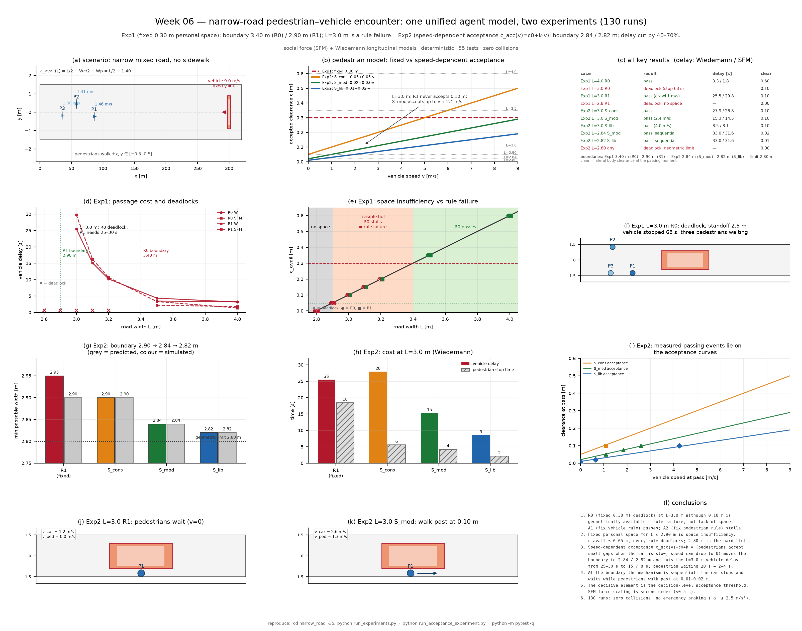

# Week 06 全部结果汇总：窄路相遇的两组实验

同一套 Agent 框架（行人与车辆参数不同）、同一组冻结初始条件、同一批运动模型（社会力 SFM / Wiedemann），做两组递进实验：

1. **实验 1（固定个人空间）**：行人只在横向余量 ≥ 0.30 m 时继续走 → 回答“多宽能过、过不去是空间不足还是规则失效”。
2. **实验 2（速度相关个人空间）**：行人按接受关系 `c_acc(v) = c0 + k·v` 决定“贴着慢车走 / 让行（速度可降到 0）” → 回答“车速极慢时行人愿意贴近穿行，该换什么模型”。

全部数字来自本仓库真实运行（实验 1：32 次；实验 2：98 次；合计 130 次），零碰撞。一页总览：



> 详细报告：[实验 1](narrow_road/report/实验报告.md) · [实验 2](narrow_road/report/实验2_速度相关接受模型.md)；项目手册：[narrow_road/README.md](narrow_road/README.md)

---

## 1 场景与统一模型

- 坐标（m, s）：x 沿路，y 横向，路中线 y=0；道路 x ∈ [0, 320] m，宽度 L 为唯一变化的道路参数。
- 行人：3 名，x ∈ [10, 90] m、y ∈ [−0.5, 0.5] m，步速 0.9–1.5 m/s，沿 +x 走；可侧移（≤1.0 m/s），不后退。
- 汽车：从 x=300 m 出现，沿 −x 驶来，期望速度 9.0 m/s；**固定在中线 y=0，只能减速/停车**。
- 主体尺寸：行人肩宽 0.5 m（外接圆 r=0.25 m），车辆 4.5 × 1.8 m。
- 初始条件由固定种子一次抽取后冻结，所有宽度/规则/模型共用；仿真无随机数，dt=0.05 s。
- 每个时间步：决策 (mode, v_target, y_target) → 控制层给加速度 → 半隐式欧拉积分 → 道路边界/不后退/不重叠约束 → 记录与判定。
- 几何余量：`c_avail(L) = L/2 − Wc/2 − Wp = L/2 − 1.40`。L=4.0 → 0.60 m；3.5 → 0.35；3.2 → 0.20；3.0 → 0.10；2.9 → 0.05；2.8 → 0.00。

| 统一量 | 行人 | 车辆 |
|---|---|---|
| 期望方向 / 速度 | +x / 0.9–1.5 m/s | −x / 9.0 m/s |
| 纵向松弛 τ / a_max / b_comfort / b_max | 0.5 / 1.5 / 2.0 / 3.0 | 0.4 / 2.0 / 2.5 / 6.0 |
| 横向机动 | 可侧移（≤1.0 m/s） | 0（y ≡ 0） |

---

## 2 实验 1：固定个人空间（R0 / R1 + 消融）

### 2.1 规则

| 规则 | 行人（c = 横向身体余量） | 车辆（v_clear = 允许通过速度） | 解析临界宽度 |
|---|---|---|---|
| R0（基准） | c < 0.30 m 时侧移/等待，WAIT 时完全僵住 | 固定 c_req = 0.30 m，余量不足即停车 | L ≥ 2·(0.30+0.90+0.50) = **3.40 m** |
| R1（修改） | 等待时继续移向路缘 | 速度相关：v_clear = (c − 0.05)/0.05 | L > 2·(0.05+0.90+0.50) = **2.90 m** |
| A1 / A2 | 只改车 / 只改人（单因素消融） | — | — |

### 2.2 结果（车辆延误，Wiedemann / SFM）

| L [m] | c_avail [m] | R0 | R1 |
|---|---|---|---|
| 4.0 | 0.60 | 通过 3.3 / 1.8 s | 通过 3.2 / 1.4 s |
| 3.5 | 0.35 | 通过 3.5 / 2.2 s | 通过 4.4 / 3.3 s |
| 3.2 | 0.20 | **僵持** | 通过 10.2 / 10.7 s |
| 3.0 | 0.10 | **僵持**（车停 68 s，3 人在车头两侧，净距 2.5 m，无接触） | 通过 25.5 / 29.8 s（约 1 m/s 蹭行） |
| 2.9 | 0.05 | **僵持** | **僵持**（2.90 为 R1 的严格边界） |
| 2.8 | 0.00 | **僵持** | **僵持** |

- **L=3.0 m 的僵持是规则失效**：几何上 0.10 m > 0.05 m 可行，行人已贴到路缘（|y|=1.25 m），车头距人 2.5 m、零接触；R1 与之几何下能过但只敢 1 m/s。
- 消融：将车规则改为速度相关（A1）即通过（29.8 s）；只改行人规则（A2）仍僵持 → 瓶颈是车辆的“固定 0.30 m 余量”条款；行人“僵住”在本参数下没有起决定作用。
- **L ≤ 2.90 m 是空间不足**：c_avail ≤ 0.05 m，任何规则都过不去；2.80 m 为几何极限。
- 16 个（宽度×规则）格子的解析预测与仿真结果 **16/16 一致**；两种运动模型定性结论一致。

---

## 3 实验 2：速度相关个人空间 / 间隙接受（S_cons / S_mod / S_lib）

### 3.1 模型

固定 0.30 m 阈值无法表达“车速越慢、行人能接受的间隙越小”。实验 2 把个人空间换成**行人与车辆共享的接受关系**：

```
c_acc(v) = c0 + k · v                         （行人当车以 v 通过时愿意接受的最小横向余量）
行人：c ≥ c_acc(v_plan) → PASS，继续贴着车走；
      c <  c_acc(v_plan) → STOP，纵向期望速度 = 0（停在路缘等待；速度可以降到 0）；
车辆：v_clear = 0.9 · (c − c0)/k              （按接受关系反解允许速度，留 10% 余量）
      并提前 car_approach_m = 12 m 减速到位，使行人看到的是“已经慢下来的车”。
SFM：车辆对行人的斥力按车速缩放 ρ(v)=clip((v/v0)^0.7, 0.15, 1)（感知风险，见 3.4 消融）。
```

| 规则 | 行人模型 | c0 [m] | k [s/m] | 解析临界宽度 | L=3.0 允许速度 |
|---|---|---|---|---|---|
| R1（对照） | 固定 0.30 m | 0.05 | 0.05 | 2.90（严格大于） | 1.00 m/s |
| S_cons | 速度接受（只换行人模型） | 0.05 | 0.05 | 2.90 | 0.90 m/s |
| S_mod | 速度接受 | 0.02 | 0.03 | **2.84** | 2.40 m/s |
| S_lib | 速度接受 | 0.01 | 0.02 | **2.82** | 4.05 m/s |

判据：S_* 下只要 `c_avail ≥ c0`，行人就能从（哪怕停住的）车侧走过，车辆等人过完再走 → `L_crit = 2(c0 + 1.40)`。

### 3.2 可通行边界（96/96 预测一致）

| 规则 | 解析临界宽度 | 仿真（采样宽度上的通过/僵持） |
|---|---|---|
| R1（固定） | 2.90（严格 >） | 2.90、2.88 僵持；2.95 起通过 |
| S_cons | 2.90 | **2.90 通过**；2.88 僵持 |
| S_mod | 2.84 | **2.84 通过**；2.82 僵持 |
| S_lib | 2.82 | **2.82 通过**；2.80 僵持 |
| — | **2.80（几何极限）** | 任何规则都不通过 |

**边界处的机制是“顺序通过”**：L=2.84（S_mod）/2.82（S_lib）时，行人通过瞬间车速为 0、余量仅 0.02/0.01 m；行人依次从停住的车侧走过，车辆再继续 → 边界处车辆延误仍达 31–39 s（“能过”≠“通行良好”）。

### 3.3 L = 3.0 m 的通行代价

| 规则 | 车辆延误 [s]（W / SFM） | 车辆最低速度 [m/s] | 行人停车总时长 [s] | 行人平均延误 [s] | 通过余量 [m] |
|---|---|---|---|---|---|
| R1（固定） | 25.5 / 29.8 | 1.19 / 0.97 | 18.45 / 21.15 | 10.00 / 9.02 | 0.10 |
| S_cons | 27.9 / 26.8 | 1.09 / 0.87 | **5.60 / 4.90** | 7.55 / 3.55 | 0.10 |
| S_mod | **15.3 / 14.5** | 2.59 / 2.38 | 4.25 / 3.70 | 7.48 / 2.80 | 0.10 |
| S_lib | **8.5 / 8.1** | 4.24 / 4.03 | 2.15 / 1.65 | 7.10 / 2.10 | 0.10 |

- 同一 0.10 m 间隙：R1 只能 1 m/s；S_mod 允许 2.4 m/s、S_lib 4.0 m/s → 车辆延误 25–30 s 降到 **15 / 8 s**。
- 行人停车总时长 18–21 s 降到 **4 / 2 s**：只在车辆尚未减速到位时短暂让行，之后贴车继续走。
- 最大减速度仍为 2.5 m/s²（舒适值），无紧急制动；最小身体距离 0.10 m，**零碰撞**。

### 3.4 现象验证与消融

- **实测通过瞬间的 (车速, 余量) 精确落在接受曲线上**：S_cons ≈ (1.09, 0.10)、S_mod ≈ (2.59, 0.10)、S_lib ≈ (4.24, 0.10) → 接受关系是模型真实产生的行为，不是事后拟合。
- **人的速度可以下降到 0**：模型里是显式 STOP 分支；轨迹中 P1 先降至 0 再恢复步行（图 A4b）；低于各自边界时（如 S_mod@2.82、S_lib@2.80）正是“所有行人停住 → 僵持”。
- **单因素分解**：S_cons 与 R1 车辆规则完全相同，只换行人模型 → 行人停车从 18.5 s 降到 5.6 s、2.90 m 由僵持变通过，但车辆延误基本不变 → 行人模型改善体验与边界可通行性；L=3.0 的车辆提速来自降低 c0（规则/工程决策，c0 必须由安全约束确定）。
- **力缩放消融**：S_mod 与“关闭 SFM 风险缩放”的 S_mod_nf 延误均为 14.52 s（差 < 0.5 s）→ 决定性要素是**决策层的间隙接受阈值**，把旧社会力幅度调小是不够的。
- 宽路不受损：4.0 m 处 S_mod 2.67 s vs R1 3.17 s（Wiedemann）；3.5 m 处 2.77 vs 4.37 s。

---

## 4 两组实验合并对比

| 维度 | 实验 1：固定个人空间 | 实验 2：速度相关接受 |
|---|---|---|
| 行人模型 | c ≥ 0.30 m 才继续走 | c ≥ c0 + k·v 才继续走；否则停（速度可为 0） |
| 车辆模型 | 固定/速度相关余量阈值 | 由接受关系反解 v_clear，并提前 12 m 减速 |
| 可通行边界 | 3.40 m（R0）/ 2.90 m（R1） | **2.84 m（S_mod）/ 2.82 m（S_lib）**，极限 2.80 m |
| 3.0 m 车辆延误 | 25–30 s（R1）/ 僵持（R0） | **15.3 s（S_mod）/ 8.5 s（S_lib）** |
| 3.0 m 行人停车总时长 | 18–21 s | **4.3 s / 2.2 s** |
| 3.0 m 通过余量 | 0.10 m | 0.10 m（S_mod/S_lib 相同几何） |
| 边界处机制 | 车辆必须挤过行人 → 余量 < 0.05 时不可能 | 车辆停住、行人从车侧走过 → 可到 0.01–0.02 m |
| 预测一致性 | 16/16 | 96/96 |
| 运行次数 / 碰撞 | 32 / 0 | 98 / 0 |

**结论**：

1. 实验 1 说明失败有两种性质——L=3.0 m 是**规则失效**（几何可行，车规则过保守），L≤2.90 m 是**空间不足**（任何规则都过不去），2.80 m 为几何极限。
2. 实验 2 回答“该换什么模型”：把**常数个人空间**换成**速度相关的间隙接受关系**，并让行人的“走/停（速度可为 0）”和车辆的“允许速度”都由同一条关系决定。边界从 2.90 m 推进到 **2.84 / 2.82 m**，L=3.0 m 车辆延误降低 40–70%，行人等待降低 80–90%。
3. 起决定作用的是**决策层的接受阈值 (c0, k)**，而不是社会力幅度；c0 是“静止时愿意接受的最小余量”，直接决定边界（`L_crit = 2(c0+1.40)`），其最小值必须由真实安全约束标定。
4. 边界附近存在高代价的“顺序通过”模式：技术可行不等于通行良好，必须同时报告延误与余量。

---

## 5 复现与产物

```powershell
cd narrow_road
python -m pip install -r requirements.txt
python run_experiments.py            # 实验 1：32 次仿真 + 指标 + 参数表 + 8 张图（约 6 s）
python run_acceptance_experiment.py  # 实验 2：98 次仿真 + 指标 + 表 + 6 张图（约 8 s）
python -m pytest -q                  # 55 个测试（约 6 s）
cd .. && python make_overview.py     # 本文件顶部的一页总览图（读取两个实验的真实产物）
```

| 产物 | 内容 |
|---|---|
| `narrow_road/outputs/` | 实验 1：metrics / ped_metrics / trajectories / predictions / prediction_consistency / tables / figures（含 summary.png） |
| `narrow_road/outputs_acceptance/` | 实验 2：metrics / ped_metrics / pass_events / trajectories / predictions / prediction_consistency / tables A1–A3 / figures（含 summary2.png） |
| `results_all.png` · `results_all.pdf` | **本文顶部的一页总览图**（12 面板） |
| `narrow_road/report/` | 两篇详细报告 |
| `narrow_road/config.yaml` | 全部参数（几何/主体/规则/模型/指标） |

---

## 6 局限

1. 单一初始条件（固定种子）、3 名行人、1 辆车、单车道路段；结论不能直接外推到真实道路设计。
2. 车辆固定在路中线且完全不能侧移；现实中司机会偏向一侧，临界宽度会降低。
3. 实验 2 的 c0、k 是三档假设值（0.05/0.05、0.02/0.03、0.01/0.02），没有用真实人车交互数据标定；应使用“行人从慢车旁经过的横向间距分布”估计。
4. 假设行人能观察到车辆的**计划通过速度**（用 car.v_target 近似），真实行人还依赖眼神、手势等协商线索。
5. “接受”是确定性阈值，未建模人群异质性（老人/儿童更保守）与左右侧协调。
6. 边界处的顺序通过依赖“司机愿意长时间等待”的规则；若司机有时间预算，行为会退回实验 1 的爬行/僵持。
7. Wiedemann 原为同向跟驰，已做显式简化推广；其自由行驶段死区会让行人重新加速后略低于 v0，使行人均延误被高估几秒（不影响车辆延误、停车时间与边界结论）。

---

## 7 参考文献

1. Helbing, D., & Molnár, P. (1995). Social force model for pedestrian dynamics. *Physical Review E*, 51(5), 4282–4286. <https://doi.org/10.1103/PhysRevE.51.4282>
2. Helbing, D., Farkas, I., & Vicsek, T. (2000). Simulating dynamical features of escape panic. *Nature*, 407, 487–490. <https://doi.org/10.1038/35035023>
3. Wiedemann, R. (1974). *Beschreibung des Verkehrsablaufs auf Straßen mittels Simulation*. Universität Karlsruhe.
4. Treiber, M., & Kesting, A. (2013). *Traffic Flow Dynamics: Data, Models and Simulation*. Springer. <https://doi.org/10.1007/978-3-642-32460-4>

