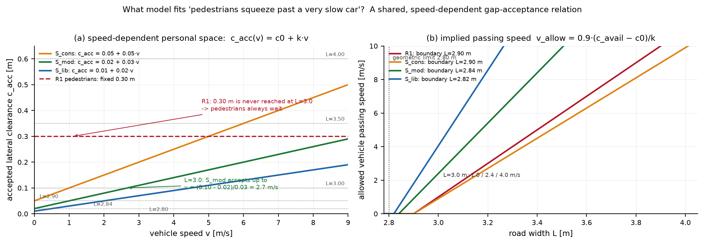
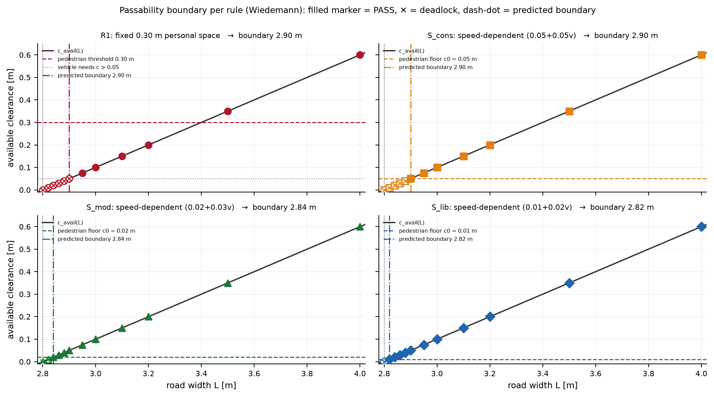
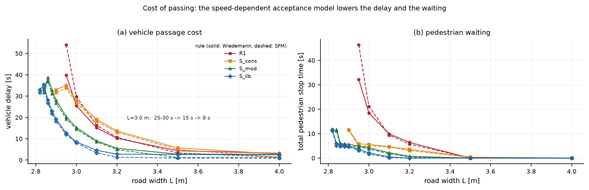
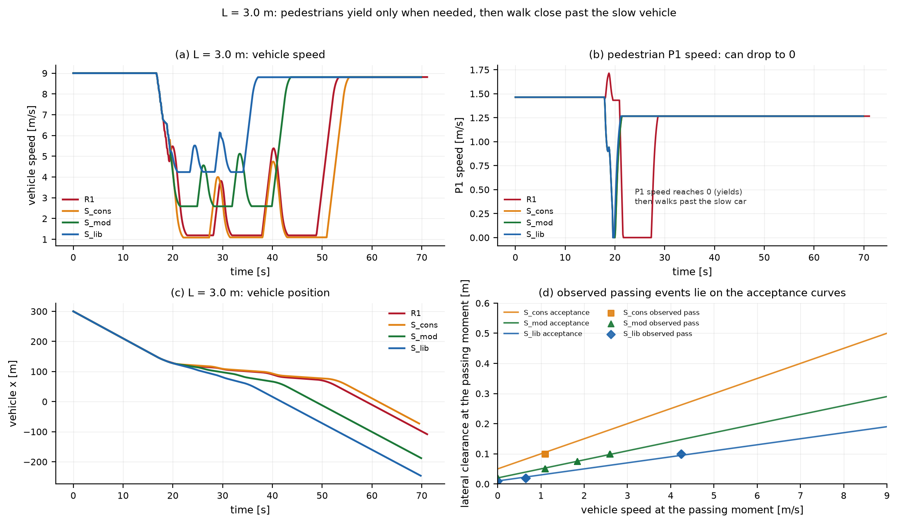
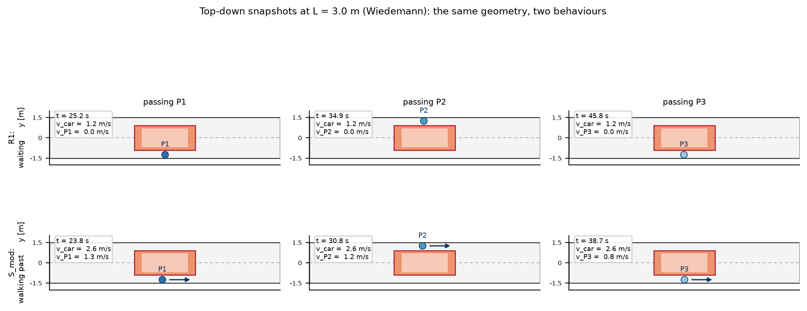

# 实验 2：速度相关的行人个人空间 / 间隙接受模型

> 背景：实验 1（见 [实验报告.md](实验报告.md)）用**固定**的 0.30 m 个人空间阈值描述行人；结果在 3.0 m 窄路上行人永远不接受 0.10 m 的余量，车辆只能以 1 m/s 爬行，R0 规则下甚至僵持。
> 但生活经验是：**车辆开得极慢时，行人愿意贴着车穿行**。固定阈值模型无法表达“车速越慢、可接受的横向间隙越小”。
> 本实验把行人模型换成**速度相关的个人空间 / 间隙接受**（speed-dependent acceptance），并在同一套 Agent 框架、同一组初始条件下重新做宽度扫描与失败分析。
>
> 全部数字来自 `run_acceptance_experiment.py` 的真实运行（98 次仿真）；实验 1 的代码路径与结果保持不变（已逐项核对，数值差 0.0）。

---

## 1 问题：固定阈值模型缺了什么

实验 1 的规则里，行人是否“让过路”只看一个常数：横向身体余量是否 ≥ 0.30 m。于是：

- L=3.0 m 时路缘最多只能给出 0.10 m 余量 → 行人**永远**处于“侧移/等待”状态，哪怕车速只有 1 m/s；
- 车辆因此必须以 1 m/s 蹭行（R1，延误 25–30 s），或在固定 0.30 m 规则下直接僵持（R0）；
- 现实中的关键机制——**行人对风险的判断随车速变化**——在模型里完全缺失。

生活经验对应的是一条**接受关系**：车速为 v 时，行人愿意接受的最小横向余量 c_acc(v) 随 v 增大而增大，v→0 时可以很小。这就是本实验要换的模型。



**图 1**（a）速度相关个人空间：c_acc(v) = c0 + k·v；虚线为旧模型的固定 0.30 m。（b）由该关系反解出的车辆允许通过速度 v_allow。

---

## 2 模型：共享的速度相关接受关系

### 2.1 接受关系

```
c_acc(v) = c0 + k · v            （c0：静止时愿意接受的最小余量；k：每 m/s 需要多出的余量）
```

这条关系由行人与车辆**共享**：行人用它判断“要不要让”，车辆用它反解“能以多快通过”。

### 2.2 行人：接受就贴着走，不接受就让行（速度可降到 0）

车辆每步先算自己的**计划通过速度** `car.v_target`；行人按它判断自己能否接受当前间隙：

| 条件 | 模式 | 纵向期望速度 | 横向 |
|---|---|---|---|
| c ≥ c_acc(v_plan) | **PASS** | v0（继续贴着车走） | 移向路缘 |
| c < c_acc(v_plan) | **STOP** | **0**（停在路缘等待，速度可降到 0） | 继续移向路缘 |
| 车辆已完全驶过 | WALK | v0 | 沿路缘继续 |

用“计划速度”而不是瞬时速度，是因为行人看到的是车辆**正在减速**这一事实；用计划速度可避免车辆还在制动时行人就提前让行。STOP 分支显式允许行人把纵向速度降到 0 并保持——这正是作业补充要求“人的速度可以下降到 0”。

### 2.3 车辆：按接受关系反解允许速度，并提前减速

```
v_clear = 0.9 · (c − c0) / k            （0.9 = 司机留 10% 余量，避免与行人阈值正好相等时的走/停抖动）
```

车辆在距行人 `car_approach_m = 12 m` 处就压到 v_clear，而不是到跟前才刹车——这样行人在做出“走/停”判断时，观察到的是一辆**已经慢下来**的车，符合“慢车 → 愿意贴近”的因果顺序。

### 2.4 力模型部分：感知风险随车速缩放（二阶）

社会力模型里，车辆对行人的斥力乘以风险因子 `ρ(v) = clip((v/v0)^0.7, 0.15, 1)`：慢车斥力弱，行人可以贴近。
**但消融显示这一项只带来二阶差异**（见 §5.5）：决定性的建模要素是**决策层的速度相关接受阈值**，而不是力的大小。

### 2.5 与实验 1 的关系

| 规则 | 行人模型 | 车辆模型 | 作用 |
|---|---|---|---|
| R1 | 固定 0.30 m | v = (c − 0.05)/0.05 | 实验 1 的修改规则（对照） |
| **S_cons** | 速度接受 (0.05, 0.05) | 同 R1（0.9 倍） | **只换行人模型**，隔离行人侧影响 |
| **S_mod** | 速度接受 (0.02, 0.03) | v = 0.9(c − 0.02)/0.03 | 中等假设 |
| **S_lib** | 速度接受 (0.01, 0.02) | v = 0.9(c − 0.01)/0.02 | 激进假设（贴近极限） |
| S_mod_nf | 同 S_mod | 同 S_mod，但 SFM 不做风险缩放 | 力模型消融 |

三档 (c0, k) 不是“调参调出来的”，而是代表对“行人到底能接受多近”的三种假设；c0 直接决定可通行边界。

---

## 3 先预测（运行前）

**边界判据**：S_* 规则下，行人只要在路缘能得到 c ≥ c0，就愿意贴着（哪怕已停住的）车走过去；车可以等行人走过再走。因此

```
可通行 ⇔ c_avail = L/2 − Wc/2 − Wp ≥ c0 ⇔ L ≥ L_crit = 2(c0 + 0.90 + 0.50)
```

| 规则 | c0 [m] | k [s/m] | 预测临界宽度 [m] | L=3.0 m 允许速度 [m/s] | 预期现象 |
|---|---|---|---|---|---|
| R1（对照） | — | — | 2.90（严格大于） | 1.00 | 行人固定 0.30 m，永远等待 |
| S_cons | 0.05 | 0.05 | 2.90 | 0.90 | 行人不再等待，车仍 0.9 m/s |
| S_mod | 0.02 | 0.03 | 2.84 | 2.40 | 车明显加快，行人在 0.10 m 处贴行 |
| S_lib | 0.01 | 0.02 | 2.82 | 4.05 | 车接近正常低速，余量仅 0.01–0.02 m |

同时预测：① 3.0 m 处车辆延误显著下降（S_mod 约降到 15 s，S_lib 约 8 s）；② 行人停车时间大幅下降（只在车辆尚未减速到位时短暂停一下）；③ 在边界宽度附近，车辆会**先停住、等行人从车侧走过、再继续**（顺序通过），因此边界处的延误反而很大（30 s 量级）；④ 2.80 m 是几何极限（c_avail = 0），任何规则都过不去。

---

## 4 实验矩阵

- 宽度：2.80, 2.82, 2.84, 2.86, 2.88, 2.90, 2.95, 3.00, 3.10, 3.20, 3.50, 4.00 m（12 个）
- 规则：R1, S_cons, S_mod, S_lib（4 个）
- 模型：社会力 SFM、Wiedemann（2 个）
- 消融：S_mod_nf at L=3.00/2.90（SFM）
- 共 **98 次仿真**；初始条件与实验 1 完全一致（同一固定种子）；`t_max = 420 s` 以容纳边界处的慢速顺序通过。

---

## 5 结果

### 5.1 可通行边界：从 2.90 m 推进到 2.82 m（几何极限 2.80 m）

| 规则 | 模型 | 解析临界宽度 [m] | 仿真结果（采样宽度上的通过/僵持） |
|---|---|---|---|
| R1 | SFM / Wiedemann | 2.90（严格大于） | 2.90、2.88 僵持；2.95 起通过 |
| S_cons | SFM / Wiedemann | 2.90 | **2.90 通过**；2.88 僵持 |
| S_mod | SFM / Wiedemann | 2.84 | **2.84 通过**；2.82 僵持 |
| S_lib | SFM / Wiedemann | 2.82 | **2.82 通过**；2.80 僵持 |

- 96 个（宽度 × 规则 × 模型）格子的解析预测与仿真结果**全部一致**（`prediction_consistency.json`，96/96）。
- R1 的“严格大于 2.90”意味着 2.90 本身仍僵持：实验 1 中 2.90 m 是“车能不能过”的边界；换成 S_cons（同一条车辆余量曲线、只改行人模型）后，2.90 m 变成**通过**——因为行人愿意从停住的车侧走过去，车辆等他们过完再走。
- 边界继续下移到 S_mod 的 2.84 m、S_lib 的 2.82 m，逼近 2.80 m 的几何极限（车身 + 行人正好占满路宽）。



**图 2** 各规则的可通行边界：黑线为 c_avail(L)，彩色虚线为规则的余量下限，点划线为解析边界；实心点 = 通过，✕ = 僵持。

**边界处的机制不是“车挤过去”，而是“人等车停、从车侧走过”**：从通过事件表可以看到，在 L=2.84 m（S_mod）与 L=2.82 m（S_lib）时，行人通过瞬间的车速为 **0.0 m/s**、余量只有 **0.02 / 0.01 m**；行人依次从停住的车侧走过之后，车辆才继续前进。这也解释了为什么边界处的车辆延误很大（31–39 s）。

### 5.2 L = 3.0 m：通行代价显著下降

| 规则 | 车辆延误 [s]（Wied / SFM） | 车辆最低速度 [m/s] | 行人停车总时长 [s] | 行人平均延误 [s] | 通过余量 [m] |
|---|---|---|---|---|---|
| R1 | 25.5 / 29.8 | 1.19 / 0.97 | 18.45 / 21.15 | 10.00 / 9.02 | 0.10 |
| S_cons | 27.9 / 26.8 | 1.09 / 0.87 | **5.60 / 4.90** | 7.55 / 3.55 | 0.10 |
| S_mod | **15.3 / 14.5** | 2.59 / 2.38 | 4.25 / 3.70 | 7.48 / 2.80 | 0.10 |
| S_lib | **8.5 / 8.1** | 4.24 / 4.03 | 2.15 / 1.65 | 7.10 / 2.10 | 0.10 |

- 同一个 0.10 m 间隙：R1 只能以 1 m/s 通过；速度相关接受模型允许 **2.4 m/s（S_mod）或 4.0 m/s（S_lib）** 通过，车辆延误从 25–30 s 降到 15 s / 8 s。
- 行人停车总时长从约 **20 s 降到 4 s（S_mod）/ 2 s（S_lib）**：行人只在车辆还没减速到位时短暂让行，之后贴着车继续走。
- 最小身体距离仍为 0.10 m，**零碰撞、零身体重叠**；最大减速度仍为舒适值 2.5 m/s²。



**图 3** 通过代价随宽度变化（实线 Wiedemann、虚线 SFM）。（a）车辆延误；（b）行人停车总时长。

### 5.3 现象验证：行人的速度确实降到 0，也确实贴着慢车走了



**图 4**（a）L=3.0 m 时各规则的车速：R1 停在约 1 m/s，S_mod/S_lib 明显更快。（b）行人 P1 的速度：先短暂降到 0（让行），随后恢复到步行速度从车侧走过。（c）车辆位置。（d）**实测通过瞬间的“车速–余量”点落在接受曲线上**——这是对模型的直接校验。

图 4(d) 是关键证据：三档规则下每一名行人被驶过的那一瞬间，实测点 (v, c) 都精确落在各自的 c_acc(v) 曲线上（S_cons ≈ (1.09, 0.10)、S_mod ≈ (2.59, 0.10)、S_lib ≈ (4.24, 0.10)），说明“接受关系”不是事后拟合，而是模型实际产生的行为。



**图 5** L=3.0 m 的俯视快照（Wiedemann）。上排 R1：行人停住等待（v=0），车以 1.2 m/s 通过；下排 S_mod：行人在 0.10 m 处以 0.8–1.3 m/s 继续走（箭头），车以 2.6 m/s 通过。同样的几何，两种行为。

### 5.4 宽路不会因此变差

| 宽度 | R1 延误 [s]（W/S） | S_mod 延误 [s]（W/S） | S_lib 延误 [s]（W/S） |
|---|---|---|---|
| 4.0 m | 3.17 / 1.37 | 2.67 / 1.07 | 2.47 / 0.92 |
| 3.5 m | 4.37 / 3.32 | 2.77 / 1.17 | 2.62 / 0.97 |

在宽路上，余量（0.60 / 0.35 m）本来就大于行人的接受阈值，行人无需让行；S 规则因为“提前 12 m 减速”而略微更平稳，延误不增反降。这说明新模型不是“用安全换效率”的粗暴妥协，而是在宽路上同样合理。

### 5.5 模型消融：决策层是关键，力缩放是二阶

| 规则（L=3.0 m，SFM） | 车辆延误 [s] | 行人停车总时长 [s] |
|---|---|---|
| S_mod（含 SFM 风险缩放） | 14.52 | 3.70 |
| S_mod_nf（关闭风险缩放） | 14.52 | 3.60 |

社会力斥力的“随车速缩放”对总体指标几乎无影响（差异 < 0.5 s）。这说明：**要把“慢车贴行”这一现象建进模型，关键是决策层的速度相关接受阈值（间隙接受关系），而不是把旧的社会力幅度调小**。力缩放保留在模型里描述“感知风险”，但不是结论的来源。

### 5.6 分解：S_cons 说明“让行人更愿意走”本身不提高车辆吞吐

S_cons 与 R1 使用**完全相同**的车辆规则（0.05 + 0.05v），只把行人从固定阈值换成速度接受模型：

- 车辆延误几乎不变（27.9 vs 25.5 s / 26.8 vs 29.8 s）；
- 但行人停车总时长从 18.5 / 21.2 s 降到 5.6 / 4.9 s，行人不再排长队等待；
- 2.90 m 处 R1 僵持、S_cons 通过（行人从停住的车侧走过）。

也就是说，行人模型改善了**行人的体验与边界处的可通行性**；而 L=3.0 m 处车辆延误的大幅下降（25–30 s → 15 s → 8 s）来自把 c0 从 0.30/0.05 降到 0.02/0.01，即“车辆愿意在多小的余量下、以多低的速度通过”——这仍是一个**规则/工程决策**，必须由安全边界约束。

---

## 6 讨论

**“该换什么模型？”** 本实验给出的答案是：

1. **把个人空间从常数换成速度的函数**（间隙接受关系 c_acc(v) = c0 + k·v），并且让这条关系同时约束行人的“走/停”和车辆的“允许速度”。行人不接受时速度可以降到 0（让行），接受时继续贴着车走——两种行为都由同一个关系决定。
2. 在这个框架下，**c0 是决定可通行边界的参数**（L_crit = 2(c0 + Wc/2 + Wp)），k 决定边界附近的通行代价；k 越小、c0 越小，窄路越“能过”，但行人与车辆之间被允许的物理余量也越小。
3. 力模型（社会力）只需承担“感知风险”的第二层修饰；把旧模型的斥力幅度整体调小是**不充分**的（消融 5.5 说明它几乎不改变结果），必须改的是决策层的间隙接受逻辑。

**代价与安全**：S_mod/S_lib 允许的通过余量只有 0.02 / 0.01 m，这在真实世界只能对应“车辆确实以步行速度通过”的情形。模型里这一点由车辆规则强制（v_clear = 0.9(c−c0)/k，余量越小速度越低，c0 处速度为 0），并且 96/96 次仿真零碰撞；但 c0 不能任意取小——它本质上是“把安全裕度交给低速”的假设，需要真实数据标定（见局限）。

**边界处的非单调代价**：在 2.84–2.86 m 附近，车辆延误并不随宽度单调增加（2.84 m 约 33 s、2.86 m 约 39 s）：前者是“车停住、等人走过”（顺序通过），后者是“车以 0.3–0.5 m/s 跟随行人”——都是高代价的极限模式。这说明“能过”与“通行良好”必须分开报告（与实验 1 的结论一致）。

---

## 7 局限

1. **c0、k 是假设值，没有用真实人车交互数据标定**。本实验用 S_cons / S_mod / S_lib 三档做敏感性分析，说明边界随 c0 线性移动；真实取值需要视频/轨迹数据（如行人从慢速车旁经过的横向间距分布）来估计。
2. **模型假设行人能观察到车辆的计划速度**（用 car.v_target 近似），并据此决定走/停；真实行人还会依赖眼神、手势、车辆姿态等信号，本模型未建模这些协商线索。
3. **“接受”被简化为确定性的阈值**：c ≥ c_acc 就走、否则停，同一参数下所有行人行为一致；真实人群存在异质性（老人/儿童更保守等），应把 c0、k 设为分布。
4. **行人的左右侧偏好固定**（按初始横向位置就近），没有建模“两人迎面挤过同一侧”的协调。
5. **边界处的顺序通过**依赖“车辆会等”的规则；如果司机不愿意长时间等待（例如有通行时间预算），行为会退回实验 1 的僵持/爬行。
6. **Wiedemann 自由行驶段的死区**会让行人重新加速后稳定在略低于 v0 的速度，从而使 Wiedemann 下的行人均延误被高估几秒（图 3b 中虚线略高）；这不影响车辆延误、停车时间与边界结论。
7. 与实验 1 相同的局限仍然成立：单一初始条件、3 名行人、1 辆车、车辆固定在路中线且不能侧移、无真实数据标定。

---

## 8 复现

```powershell
cd narrow_road
python run_acceptance_experiment.py        # 98 次仿真 + 指标 + 表 + 图（约 8 s）
python run_acceptance_experiment.py --no-figures
python -m pytest -q                        # 55 个测试（含实验 1 与实验 2）
```

| 产物 | 内容 |
|---|---|
| `outputs_acceptance/metrics.csv` | 98 次仿真的汇总指标 |
| `outputs_acceptance/ped_metrics.csv` | 每名行人的指标 |
| `outputs_acceptance/pass_events.csv` | 每次“被车辆驶过”瞬间的车速/余量/行人速度（图 4d 的数据） |
| `outputs_acceptance/trajectories/*.csv` | 关键情景轨迹 |
| `outputs_acceptance/predictions.json` · `prediction_consistency.json` | 解析预测与 96/96 一致性检查 |
| `outputs_acceptance/tables/A1–A3.md` | 接受模型参数表、结果表、边界对照表 |
| `outputs_acceptance/figures/figA1–A5, summary2` | 本报告全部插图 |

