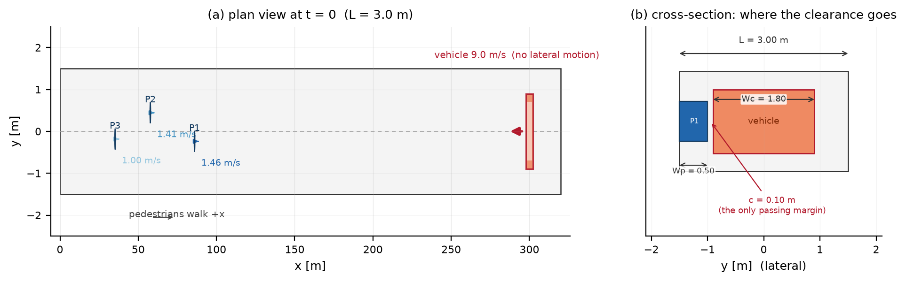
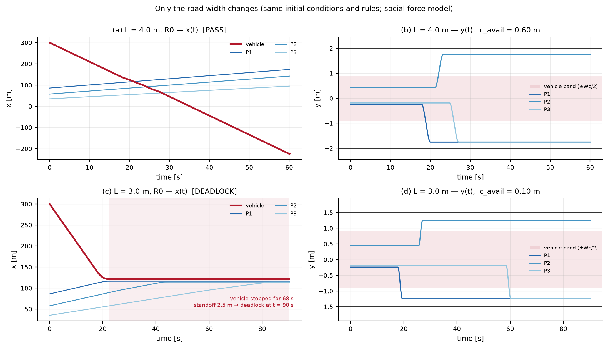
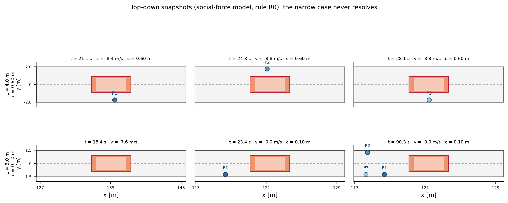
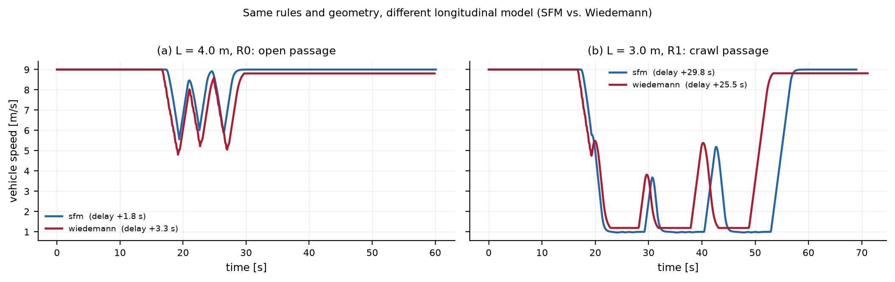
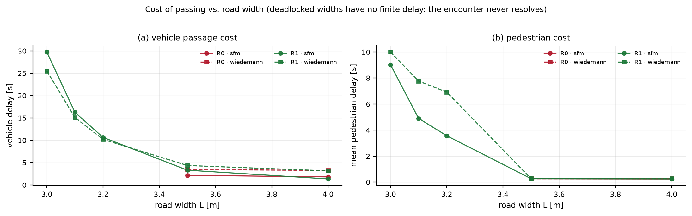
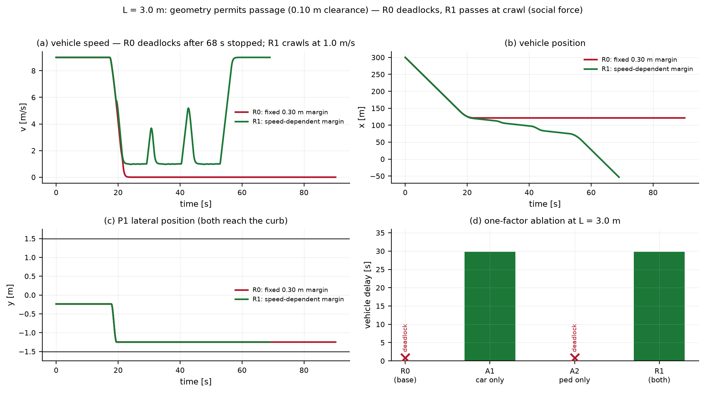
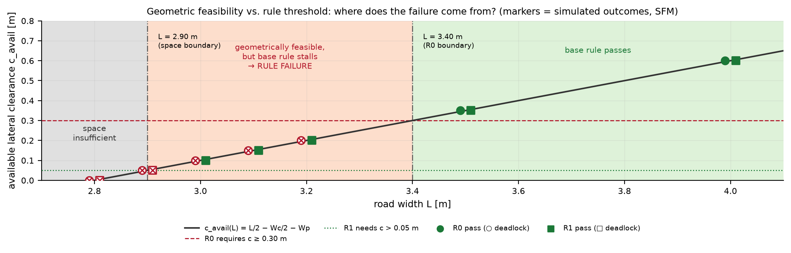

# 窄路相遇实验报告：统一人-车模型的规则设计与失效分析

> Week 06 / 微观交通仿真实验
> 全部数字来自本仓库 `run_experiments.py` 的真实运行（32 次仿真），无任何手工填写的曲线或指标。
> 复现命令见文末；解析预测与仿真结果的一致性检查见 `outputs/prediction_consistency.json`（16/16 一致）。
>
> **本报告是实验 1（固定个人空间）的记录。** 针对“车辆极慢时行人愿意贴近穿行”的新模型与实验见
> [实验 2：速度相关接受模型](实验2_速度相关接受模型.md)：可通行边界由 2.90 m 推进到 2.84 / 2.82 m
> （几何极限 2.80 m），L=3.0 m 车辆延误由 25–30 s 降到 15 / 8 s。

---

## 摘要

在同一条无路口、无信号灯、无人行道的窄路上，少量行人沿 +x 方向步行，一辆汽车从右侧沿 −x 迎面驶来；行人可以侧移，汽车只能减速或停车。实验用**同一个 Agent 框架**同时表征行人与车辆（参数不同），并比较两种运动模型（社会力 SFM、Wiedemann 阈值模型）与两套交互规则（R0 固定安全余量、R1 速度相关安全余量）。

主要结果：

| 道路宽度 | 基准规则 R0 | 修改规则 R1 | 诊断 |
|---|---|---|---|
| 4.0 m | 通过（车辆延误 1.8–3.3 s） | 通过（1.4–3.2 s） | 宽路几乎无冲突 |
| 3.5 m | 通过（2.2–3.5 s） | 通过（3.3–4.4 s） | 仍有 0.35 m 余量 |
| 3.0 m | **僵持**（车辆停 68 s，行人在车头两侧等待） | **通过但代价大**：以约 1 m/s 蹭行，延误 25.5–29.8 s，最小身体余量 0.10 m | 几何可行 → **规则失效** |
| 2.8 m | **僵持** | **僵持** | 几何余量 0 → **空间不足** |

单因素消融表明：L=3.0 m 的僵持由**车辆固定 0.30 m 余量规则**造成——只改车规则（A1）即可恢复通行，只改行人规则（A2）仍然僵持；行人的"等待时僵住"在本参数下没有成为瓶颈。所有 32 次运行**均无身体重叠、无紧急制动**（最大减速度 2.5 m/s²，等于舒适减速度），僵持时车头距行人仍有 2.5 m，因此失败是**交互规则/几何**问题，不是数值碰撞。

---

## 1 实验设计

### 1.1 场景与坐标

- 笛卡尔坐标，单位 m、s；x 为沿路方向，y 为横向，路中线 y = 0。
- 道路 x ∈ [0, 320] m，宽度 L 为唯一被改变的道路参数。
- 3 名行人分布在 x ∈ [10, 90] m、y ∈ [−0.5, 0.5] m，以随机期望步速 0.9–1.5 m/s 沿 +x 步行。
- 汽车从 x = 300 m 处出现，沿 −x 行驶，期望速度 9.0 m/s，**固定在中线 y = 0，不可侧移**。
- 无路口、无信号灯、无人行道；行人圆心被约束在 |y| ≤ L/2 − Wp/2（身体不越出路缘）。

初始条件由固定种子（20261023）**一次抽取后冻结**，写入 `outputs/initial_conditions.json`，所有宽度 / 规则 / 模型共用同一组初始位置与速度——因此宽度比较是严格受控的。抽取结果：

| 行人 | 起点 x [m] | 起点 y [m] | 期望速度 [m/s] |
|---|---|---|---|
| P1（最先与车辆相遇） | 86.01 | −0.238 | 1.464 |
| P2 | 57.73 | +0.443 | 1.412 |
| P3 | 35.23 | −0.184 | 1.002 |

### 1.2 变量与对照设计

| 维度 | 取值 | 说明 |
|---|---|---|
| 道路宽度 L | 4.0 / 3.5 / 3.2 / 3.1 / 3.0 / 2.9 / 2.8 m | 主实验 4 个宽度 + 扫描补点 |
| 交互规则 | R0（基准）、R1（修改）、A1/A2（消融） | 见第 3 节 |
| 运动模型 | SFM、Wiedemann | 见第 4 节 |
| 初始条件 | 固定（同一组） | 唯一变化的道路参数是宽度 |

共 32 次仿真（4 宽度 × 2 规则 × 2 模型 = 16 次主实验；L=3.0 的 2 个消融 × 2 模型 = 4 次；扫描补点 3 宽度 × 2 规则 × 2 模型 = 12 次）。



**图 1**（a）t=0 平面图；（b）通过时刻的横断面：道路宽度 L、车身宽 Wc、行人肩宽 Wp 与真正可用于通过的身体余量
`c_avail = L/2 − Wc/2 − Wp`。L=3.0 m 时 c_avail = 0.10 m。

### 1.3 统一模型框架

行人与车辆共用同一个 `Agent` 状态与同一套仿真循环，差异只在参数与角色阈值：

```
每个时间步：
  1. 感知/决策层：由同一套规则（第 3 节）给出 (mode, v_target, y_target)
  2. 控制层：    由同一族运动模型（第 4 节，SFM 或 Wiedemann）给出加速度 a(t)
  3. 积分：      v(t+dt) = clip(v(t) + a(t)·dt)
                 x(t+dt) = x(t) + v(t+dt)·dt      （半隐式欧拉，dt = 0.05 s）
  4. 约束：      道路边界、行人不得后退、身体不重叠的硬安全投影
  5. 记录/判定： 指标、僵持、结束条件
```

| 统一量 | 行人 | 车辆 |
|---|---|---|
| 形状 | 外接圆 r = Wp/2 = 0.25 m | 矩形 4.5 × 1.8 m（社会力用 3 圆近似） |
| 期望方向 | +x | −x |
| 期望速度 v0 | 0.9–1.5 m/s（随机） | 9.0 m/s |
| 纵向松弛时间 τ | 0.5 s | 0.4 s |
| 最大加速度 a_max | 1.5 m/s² | 2.0 m/s² |
| 舒适/最大减速度 | 2.0 / 3.0 m/s² | 2.5 / 6.0 m/s² |
| 横向机动 α | 1（可侧移，v_lat ≤ 1.0 m/s） | 0（锁死，y ≡ 0） |
| 交互规则参数 | d_alert = 25 m，d_wait = 5 m，c_pass = 0.30 m | d_conflict = 30 m，d_standoff = 3 m，g_stop = 2 m |

### 1.4 每个时间步的位置更新（作业第 1 步）

对任意 Agent i，记其行驶方向单位向量 e_i（行人 +x，车辆 −x），沿向速度 s_i = e_i·v_i：

1. **加速度**：控制层输出 a_i（纵向）与（仅行人）a_i^lat；对车辆横向加速度恒为 0。
2. **速度更新**：`v_i ← v_i + a_i·e_i·dt + a_i^lat·n_i·dt`，其中 n_i = (0, 1)。
3. **速度约束**：
   - 行人：`v_x ≥ 0`（只前进/侧移/停止，不后退），`|v_y| ≤ 1.0 m/s`，`|v| ≤ 1.8 m/s`；
   - 车辆：`v_x ≤ 0`（不倒车），`v_y = 0`。
4. **位置更新**：`x_i ← x_i + v_x·dt`，`y_i ← y_i + v_y·dt`。
5. **边界与安全约束**：
   - 行人：`y ← clip(y, −(L/2 − Wp/2), +(L/2 − Wp/2))`，触界时 `v_y = 0`；
   - 车辆与横向重叠行人：纵向净距不得小于 g_stop = 2 m；
   - 行人身体与车辆矩形、行人之间：若发生重叠，沿最小穿透方向投影分开（记录为约束事件）。
6. **记录**：时间、位置、速度、模式、期望速度、到车辆净距与横向余量。

### 1.5 参数表

完整参数见 `config.yaml`（代码不写死任何数值），生成的 Markdown 参数表见 `outputs/tables/01_geometry_and_motion.md`、`02_rules.md`、`03_models.md`。

---

## 2 交互设计（作业第 2 步）

行人与车辆共用同一套"感知—决策"引擎，只是角色阈值不同。所有阈值集中写在 `config.yaml` 的 `rules` 段。

### 2.1 行人：何时继续走 / 侧移 / 等待

记 `g` 为行人车头到车辆车头的纵向净距，`c` 为两者的横向身体余量（c = |Δy| − (Wc+Wp)/2，负值表示横向投影重叠）。

| 条件 | 模式 | 期望速度 | 横向目标 |
|---|---|---|---|
| 车辆尚未完全驶过，且 `c < 0.30 m`，且 `5 m < g ≤ 25 m` | SIDESTEP | 0.85·v0 | 就近路缘 ±(L/2 − Wp/2) |
| 同上，但 `g ≤ 5 m` | WAIT | 0 | R0/A1：就地**僵住**；R1/A2：继续移向路缘 |
| 车辆已完全驶过，或 `c ≥ 0.30 m` | WALK | v0 | 若已让过路则沿路缘继续走 |
| 前方 8 m 内有同行行人且横向偏离 < 0.7 m | 跟驰限速 | ≤ √(2·b·max(g−1, 0)) | — |

"就近路缘"由行人初始横向位置决定（P1、P3 靠 −y 侧，P2 靠 +y 侧），选定后不再改变，避免左右摇摆。

### 2.2 车辆：何时减速 / 停车 / 恢复前进

对每一个前方（含并行）行人，取三个约束的最小值：

1. **物理安全约束**（行人仍在车辆行驶路径内，c < 0）：
   `v ≤ √(2·b_plan·max(g − 2, 0)) − v_ped`，其中 v_ped 为行人迎面走来的速度；
2. **规则允许速度**：
   - R0（固定余量）：`c ≥ 0.30 m` 才允许 v0 通过，否则 `v_clear = 0`；
   - R1（速度相关余量）：`v_clear = (c − 0.05) / 0.05`（余量越小，允许速度越低），上限 v0；
   - 若 `v_clear = 0`：在行人前方 3 m 处停住，`v ≤ √(2·b_plan·max(g−3,0)) − v_ped`；
   - 若 `0 < v_clear < v0`：以可行动力学剖面接近，`v ≤ √(v_clear² + 2·b_plan·max(g−4,0))`；
   - 正并行时保持 v ≤ v_clear，直到车尾完全超过该行人；
3. **恢复前进**：规则每步重新计算，一旦所有前方行人都满足通过条件，v_target 自动恢复到 v0。R0 的恢复条件是"所有人 c ≥ 0.30"；R1 是"按当前余量允许 1 m/s 以上"。

其中 b_plan = 2.0 m/s² 小于控制器舒适减速度 2.5 m/s²，保证车辆能跟踪停车/接近曲线而不冲过停车线。

### 2.3 规则集与消融

| 规则 | 行人 WAIT 时 | 车辆余量判据 | 解析可通行条件 |
|---|---|---|---|
| **R0**（基准） | 完全僵住 | 固定 c_req = 0.30 m | L ≥ 2·(0.30 + 0.90 + 0.50) = **3.40 m** |
| **R1**（修改） | 继续移向路缘 | v_clear = (c − 0.05)/0.05 | L > 2·(0.05 + 0.90 + 0.50) = **2.90 m** |
| A1（消融：只改车） | 完全僵住 | 同 R1 | L > 2.90 m |
| A2（消融：只改人） | 继续移向路缘 | 同 R0 | L ≥ 3.40 m |

---

## 3 两种运动模型

两个模型共用决策层与积分器，只替换纵向加速度的生成方式；它们是行人与车辆**共用的同一族模型**（同一代码路径，参数不同）。

### 3.1 社会力模型（SFM）

对行人 i（全向移动体）：

```
a_i = (v_target·e_i − v_i)/τ + Σ_j A_ij·exp(−d_ij^clear / B_ij)·w(φ_ij)·n_ij
w(φ) = λ + (1−λ)(1+cosφ)/2          # 各向异性：正前方 1，正后方 λ
```

- 行人←车辆：A = 2.0 m/s²、B = 0.25 m、λ = 0.2（车辆用三个半径 0.9 m 的圆近似）；
- 行人↔行人：A = 2.0 m/s²、B = 0.30 m、λ = 0.2；
- 车辆←行人：A = 0.8 m/s²、B = 0.25 m、λ = 0.1，只保留沿行驶方向的制动分量，且斥力不允许把车往前推。

由此，车辆的减速部分来自规则给出的 v_target，部分来自对路径内行人的指数斥力；行人的侧移来自决策层横向目标 + 车辆斥力。

### 3.2 Wiedemann 心理-物理阈值模型（简化实现）

```
s_des   = SDX + T·s                # 期望净距，SDX = 1.0 m，T = 1.5 s（车）/1.2 s（人）
s_brake = s_des + u²/(2·b)         # BX 制动阈值
s_react = s_des + u·t_react        # AX 接近阈值
若 s ≤ s_brake            -> 制动 regime：a = clip(−u²/(2·max(s−SDX,0.3)), −b_max, −b_comfort)
若 s ≤ s_react 且 u > SDV -> 接近 regime：同上但允许较轻减速
若 s < s_des              -> 跟驰 regime：a = clip(k_gap·(s−s_des) − k_v·u, −b_comfort, a_max)
否则                       -> 自由行驶：向 v_target 平滑收敛
```

其中 s 为车头-车尾净距、u 为接近速度、SDV = 0.2 m/s 为速度差感知阈值。交互项只允许让车/人多减速，不越过决策层给出的期望速度。原版 Wiedemann 74 用于同向跟驰，这里将其推广到"迎面行人"情形（把行人视为行驶路径内的前车，接近速度取沿行驶方向的相对速度），属显式简化，见第 8 节局限。

### 3.3 解析可通行判据（用于"先预测"）

行人贴到路缘时能得到的最大横向余量只取决于道路宽度与两个主体的宽度：

```
c_avail(L) = L/2 − Wc/2 − Wp = L/2 − 1.40
```

于是：R0 可通行 ⇔ c_avail ≥ 0.30 ⇔ L ≥ 3.40 m；R1 可通行 ⇔ c_avail > 0.05 ⇔ L > 2.90 m。这个判据不含任何动力学假设，用来在运行前做预测。

---

## 4 先预测（运行前）

### 4.1 几何预测

| L [m] | c_avail [m] | R0 要求 0.30 → 预测 | R1 需要 > 0.05 → 预测 | R1 允许通过速度 [m/s] |
|---|---|---|---|---|
| 4.0 | 0.60 | 通过 | 通过 | 11.0（不限制，v0 = 9） |
| 3.5 | 0.35 | 通过 | 通过 | 6.0 |
| 3.2 | 0.20 | **僵持** | 通过 | 3.0 |
| 3.1 | 0.15 | **僵持** | 通过 | 2.0 |
| 3.0 | 0.10 | **僵持** | 通过 | 1.0 |
| 2.9 | 0.05 | **僵持** | **僵持**（v_clear = 0） | 0 |
| 2.8 | 0.00 | **僵持** | **僵持** | 0 |

### 4.2 定性预测

1. **4.0 m**：行人只需侧移约 1.3 m 即可让出 0.60 m 余量；车辆在行人尚未让开时会被物理安全约束轻微减速，随后恢复 → 预计延误 1–4 s，无停车。
2. **3.0 m**（R0）：行人贴边后只有 0.10 m 余量，永远达不到 0.30 m → 车辆停住、行人等待 → **僵持**；预计停车位置距行人 2–3 m。
3. **3.0 m**（R1）：余量 0.10 m 允许约 1 m/s 蹭行 → 通过，但延误可达 20–30 s，最小身体余量 0.10 m。
4. **2.8 m**（R1）：几何余量为 0，任何规则都无法通过 → **空间不足**。
5. 两种运动模型的定性结论应一致（通过/僵持由规则与几何决定），定量延误可以不同。

---

## 5 两种宽度的结果（作业第 3 步）

### 5.1 指标

主实验全部 16 次运行（每格为 SFM / Wiedemann）：

| L [m] | 规则 | 结果 | 车辆延误 [s] | 最小车速 [m/s] | 最大减速度 [m/s²] | 通过余量 [m] | 行人平均延误 [s] | 碰撞/重叠 |
|---|---|---|---|---|---|---|---|---|
| 4.0 | R0 | 通过 / 通过 | 1.82 / 3.27 | 5.56 / 4.80 | 2.19 / 2.50 | 0.60 | 0.25 / 0.27 | 0 |
| 4.0 | R1 | 通过 / 通过 | 1.37 / 3.17 | 6.10 / 4.80 | 2.12 / 2.50 | 0.60 | 0.25 / 0.27 | 0 |
| 3.5 | R0 | 通过 / 通过 | 2.17 / 3.47 | 5.23 / 4.80 | 2.21 / 2.50 | 0.35 | 0.27 / 0.27 | 0 |
| 3.5 | R1 | 通过 / 通过 | 3.32 / 4.37 | 6.01 / 4.80 | 2.17 / 2.50 | 0.35 | 0.27 / 0.27 | 0 |
| 3.0 | R0 | **僵持** / **僵持** | — | 0 | 2.50 | 0.10 | — | 0 |
| 3.0 | R1 | 通过 / 通过 | 29.77 / 25.52 | 0.97 / 1.19 | 2.50 | 0.10 | 9.02 / 10.00 | 0 |
| 2.8 | R0 | **僵持** / **僵持** | — | 0 | 2.50 | 0.00 | — | 0 |
| 2.8 | R1 | **僵持** / **僵持** | — | 0 | 2.50 | 0.00 | — | 0 |

车辆自由流行驶时间（300 → 0 m，9 m/s）为 **33.58 s**，表中"车辆延误"= 实际通过时刻 − 33.58 s。

### 5.2 较宽情形 L = 4.0 m



**图 2** 上排：L=4.0 m；下排：L=3.0 m。左列为 x(t) 轨迹，右列为横向位置 y(t)。

- 行人在 t≈19–26 s 之间移向路缘（−1.75 m / +1.75 m），车辆在 t≈22–31 s 依次通过三人，最小身体余量 0.60 m。
- 车辆并不是"完全不受影响"：当行人还没让开、仍处于车辆横向投影内时，物理安全约束要求车辆按 `√(2b(g−g_stop)) − v_ped` 减速，所以车速从 9 m/s 降到 5–6 m/s，随后恢复 9 m/s，产生 1.4–3.3 s 延误。
- 行人只损失 0.25–0.27 s 的前进时间（他们边侧移边继续走），没有停车。
- 全过程最大减速度 2.2–2.5 m/s²，未用到紧急制动（6 m/s²），与行人最近身体距离 0.60 m。

### 5.3 较窄情形 L = 3.0 m

- **R0**：车辆在 t = 22.4 s 停住（车头停在 x = 121.4 m），三名行人先后到达并在车头两侧等待（P1 在 −1.25 m、P2 在 +1.25 m、P3 在 P1 后方），车头到 P1 的净距 2.53 m；直到 t = 90.3 s 仍无人移动 → 判定僵持。**没有任何接触**（最小身体距离 2.55 m），因此不是碰撞，而是行为僵局。
- **R1**：同一几何、同一初始条件下，车辆以约 1 m/s 从行人侧面蹭行通过，通过时刻 63.35 s（SFM）/ 59.10 s（Wiedemann），延误 29.77 / 25.52 s；最近时车身与行人身体只有 0.10 m，行人累计停车等待 21.2 / 18.5 s（三人合计），行人平均延误 9.0 / 10.0 s。
- 两者对比说明：**L=3.0 m 的通行能力完全由规则阈值决定**——几何上能过（0.10 m），R0 却判"不能过"。



**图 3** 俯视快照（社会力模型、R0）。上排 L=4.0 m：车辆依次通过 P1、P2、P3，余量 0.60 m；下排 L=3.0 m：车辆停住、行人在车头两侧等待，直到最后一人到达仍无解。

### 5.4 两种模型的差异



**图 4** 同一规则、同一几何下 SFM 与 Wiedemann 的车速剖面。

- 在 4.0 / 3.5 m 宽路，Wiedemann 的延误比 SFM 大 1.0–1.6 s（3.27 vs 1.82、3.47 vs 2.17）：阈值模型在接近/制动 regime 中更早、更硬地制动，恢复也更慢。
- 在 3.0 m 的蹭行情形，Wiedemann 反而略快（25.52 vs 29.77 s）：它的自由行驶段在低目标速度下收敛更快。
- **16 个"宽度 × 规则"格子中，两种模型的通过/僵持结论完全一致**；模型只改变定量延误（差异 ≤ 约 15%），不改变定性结论。这符合实验设计：定性边界由几何与规则阈值决定，模型只影响代价。

---

## 6 寻找失败：继续缩窄（作业第 4 步）



**图 5** 通过代价随宽度的变化（只画通过的情形；僵持宽度没有有限延误）。L=3.0 m 时车辆延误陡增到 25–30 s，行人平均延误 9–10 s。

### 6.1 宽度扫描结果

| L [m] | c_avail [m] | R0（SFM / Wied） | R1（SFM / Wied） |
|---|---|---|---|
| 4.0 | 0.60 | 通过 / 通过 | 通过 / 通过 |
| 3.5 | 0.35 | 通过 / 通过 | 通过 / 通过 |
| 3.2 | 0.20 | **僵持** / **僵持** | 通过（10.67 / 10.22 s） |
| 3.1 | 0.15 | **僵持** / **僵持** | 通过（16.27 / 15.12 s） |
| 3.0 | 0.10 | **僵持** / **僵持** | 通过（29.77 / 25.52 s） |
| 2.9 | 0.05 | **僵持** / **僵持** | **僵持** / **僵持** |
| 2.8 | 0.00 | **僵持** / **僵持** | **僵持** / **僵持** |

### 6.2 案例 A：L = 3.0 m、规则 R0 —— 规则失效

**现象**：车辆停 68 s、三名行人全部到达并停在车头两侧，再无人移动（图 3 下排、图 6）。

**判断**：这是**规则失效**，不是空间不足。证据链：

1. 几何可行：c_avail = 0.10 m > 0.05 m（几何最小余量），行人确实已经贴到路缘（最终 |y| = 1.25 m = L/2 − Wp/2），车辆与行人身体最近距离 2.55 m，从未接触；
2. 修改规则即可通过：把车辆判据从"固定 0.30 m"改成"速度相关余量"（R1），同一几何下以约 1 m/s 通过，代价是 25.5–29.8 s 延误；
3. 消融定位到具体条款（见 6.4）。

### 6.3 案例 B：L = 2.8 m —— 空间不足

**现象**：R0 与 R1 都僵持；车辆停住、行人在路缘等待，最小身体距离 2.54–2.91 m（同样无接触）。

**判断**：这是**空间不足**。行人贴到路缘时 |y| = 1.15 m，车辆半宽 0.90 m，两者身体恰好相切（c = 0）；任何"通过"都意味着身体重叠。可以证明：只要 L ≤ 2.90 m，c_avail ≤ 0.05 m ≤ c_min，R1 的允许速度 `(c−0.05)/0.05` 也为 0，因此**不存在任何规则能让车辆通过**。修改规则（R1）在 2.8 m 仍然僵持，正是这一判断的对照实验。

L = 2.9 m 是边界：c_avail = 0.05 m = c_min，R1 的允许速度恰为 0，因此同样僵持。这与解析判据 `L > 2.90 m` 严格一致。



**图 6** L=3.0 m 的失败与规则修改：R0 下车辆停住并僵持；R1 下以约 1 m/s 蹭行通过（+30 s 延误）；(d) 为单因素消融。

### 6.4 规则修改与单因素消融

| 规则（L=3.0 m，SFM） | 车辆余量判据 | 行人 WAIT 时 | 结果 | 车辆延误 |
|---|---|---|---|---|
| R0（基准） | 固定 0.30 m | 僵住 | **僵持** | — |
| A1（只改车） | 速度相关 | 僵住 | **通过** | 29.77 s |
| A2（只改人） | 固定 0.30 m | 继续移向路缘 | **僵持** | — |
| R1（两者都改） | 速度相关 | 继续移向路缘 | **通过** | 29.77 s |

结论：在 L=3.0 m 的失败中，**起决定作用的是车辆"固定 0.30 m 余量"这一条规则**（A2 只改行人仍然僵持；A1 只改车即恢复通行）。行人的"等待时僵住"在本参数下没有成为瓶颈——因为在车辆逼近前，行人已经到达路缘（图 6c：两种规则下 P1 都在 t≈19 s 到达 −1.25 m），此后的差异全部来自车辆规则。这一负结果同样重要：它说明并非所有"看起来不合理"的规则都会导致失败，必须用消融实验定位。

Wiedemann 模型下消融结论完全相同（A1 = R1 = 25.52 s，A2 = R0 = 僵持），进一步说明结论由规则决定，与运动模型无关。

### 6.5 空间不足与规则失效的分界



**图 7** 几何可行性与规则阈值的对照。横轴为宽度，纵轴为贴边后能得到的最大余量 c_avail(L)；两条水平线分别是 R0 与 R1 的阈值。散点为仿真结果（SFM）。

- **L ≤ 2.90 m：空间不足区**（灰）。c_avail ≤ 0.05 m，任何规则都无法通过；R1 在 2.8 / 2.9 m 的僵持验证了这一点。
- **2.90 m < L < 3.40 m：规则失效区**（橙）。几何可行但 R0 固定 0.30 m 的要求无法满足；R0 在 3.0 / 3.1 / 3.2 m 僵持，R1 在同样宽度全部通过。
- **L ≥ 3.40 m：基准规则可通行区**（绿）。4.0 / 3.5 m 两种规则都通过。

这三条边界与 `c_avail = L/2 − 1.40` 的解析判据严格吻合，并且 16 个（宽度 × 规则）格子的仿真结果与分析预测**全部一致**（`outputs/prediction_consistency.json`，16/16）。

---

## 7 讨论

1. **"窄路失败"的两种性质必须分开**：空间不足时增加规则复杂度无济于事（2.8 m 任何规则都僵持）；规则失效时，同一条路其实能过，只是规则阈值把可行的低速通过判成了不可行（3.0 m，0.10 m 余量下以 1 m/s 通过）。作业要求的"判断空间不足还是规则失效"，在本实验中对应的是两条可计算的边界（2.90 m 与 3.40 m），而不是主观判断。
2. **规则设计建议**（由实验直接得到）：
   - 安全余量阈值不应是固定值，而应随速度降低而收紧（R1 的线性关系 `c_req(v) = 0.05 + 0.05·v` 是本文采用的一个简单实现）；
   - 在余量不足以常速通过时，应允许"低速蹭行"而不是"要么放行、要么停车"的二值逻辑；
   - 行人的"等待"应定义为"停在安全位置等待"，而不是"原地僵住"；
   - 车辆必须能跟踪可行动力学剖面（规划减速度 < 控制舒适减速度），否则会冲过停车线（这是实现中真实出现过的问题）。
3. **代价不对称**：L=3.0 m 的通过代价对双方都很高（车辆 25–30 s，行人各约 9–10 s），说明"能过"不等于"通行良好"；仅用通过/不通过的二元指标会掩盖这一点。
4. **模型差异的量级**：SFM 与 Wiedemann 的延误差异 0–15%，小于规则变化带来的差异（0 → 30 s 或僵持），因此本实验的核心结论对运动模型的选择不敏感。

---

## 8 局限（如实说明）

1. **车辆固定在中线、且完全不能侧移**。现实中 3 m 窄路上的司机会主动偏向一侧，把更多余量留给行人；若允许车辆选择横向偏移，临界宽度会明显降低。本实验按题目设定"车只能沿直路减速或停车"处理，因此 2.90 / 3.40 m 是与该设定绑定的结论。
2. **行人决策阈值（d_alert = 25 m、d_wait = 5 m、c_pass = 0.30 m）与模型参数均为设定值**，没有用真实人车交互数据标定；R0/R1 的比较是同一套参数下的受控对照，不代表真实人群的最优行为。
3. **Wiedemann 模型原用于同向跟驰**，本文把它推广到"迎面行人"（把行人视为路径内前车、接近速度取相对速度），并做了自由行驶段的比例化实现；这不是对原模型的严格复现。SFM 也做了加速度量纲、车辆三圆近似与纵向投影等工程化处理。
4. **单一初始条件、3 名行人、1 辆车**：种子固定，没有做随机种子的批量统计；因此"延误 25.5–29.8 s"这类数字是这一组初始条件下的结果，不是分布。固定种子的目的是让"只改变宽度"的对照严格成立。
5. **行人不允许后退**：这是为避免社会力把行人沿 −x 推走而加的约束，与"人不会倒退"的直觉一致，但会略微限制 SFM 的解空间。
6. **僵持判定采用"过去 8 s 内双方净位移 < 0.25 m"**，并把车前行人范围设为 40 m；L=3.0 m 的僵持直到第三名行人到达后（t≈82 s）才被判定，因此表中僵持时刻（≈90 s）晚于车辆实际停车时刻（≈22 s）。这是判定口径，不是物理过程的持续时间。
7. **没有行人-车辆接触力标定、没有侧向加速度约束之外的动力学、没有考虑能见度/注意力/沟通（招手、让行手势）**。真实窄路上的协商往往依赖这些因素。

---

## 9 复现方式与产物

```powershell
cd narrow_road
python -m pip install -r requirements.txt
python run_experiments.py          # 仿真 + 指标 + 参数表 + 全部图（约 6 s）
python -m pytest -q                # 38 个测试（约 5 s）
```

| 产物 | 内容 |
|---|---|
| `outputs/metrics.csv` | 32 次仿真的汇总指标 |
| `outputs/ped_metrics.csv` | 每名行人的指标 |
| `outputs/trajectories/*.csv` | 主实验与消融情景的逐时刻轨迹 |
| `outputs/initial_conditions.json` | 冻结的初始条件 |
| `outputs/predictions.json` | 运行前的解析可通行判据 |
| `outputs/prediction_consistency.json` | 解析预测 vs 仿真结果（16/16 一致） |
| `outputs/summary.json` | 报告用关键数字 |
| `outputs/tables/*.md` | 几何/规则/模型/结果四张表 |
| `outputs/figures/*.png,*.pdf` | 本报告全部插图 |

**可复现性**：初始条件由固定种子生成，仿真不含随机数。同一输出目录下连续两次完整运行，全部 CSV / JSON / Markdown / PNG 产物逐字节一致（本机已验证；PDF 含生成时间戳，故不比较字节）。`test_determinism` 校验仿真层确定性，`test_prediction_consistency_and_artifacts` 校验指标内部一致性、轨迹与指标互相校验、解析预测 16/16 一致。

---

## 参考文献

1. Helbing, D., & Molnár, P. (1995). Social force model for pedestrian dynamics. *Physical Review E*, 51(5), 4282–4286. <https://doi.org/10.1103/PhysRevE.51.4282>
2. Helbing, D., Farkas, I., & Vicsek, T. (2000). Simulating dynamical features of escape panic. *Nature*, 407, 487–490. <https://doi.org/10.1038/35035023>
3. Wiedemann, R. (1974). *Beschreibung des Verkehrsablaufs auf Straßen mittels Simulation*. Schriftenreihe des Instituts für Verkehrswesen, Universität Karlsruhe.
4. Treiber, M., & Kesting, A. (2013). *Traffic Flow Dynamics: Data, Models and Simulation*. Springer. <https://doi.org/10.1007/978-3-642-32460-4>

