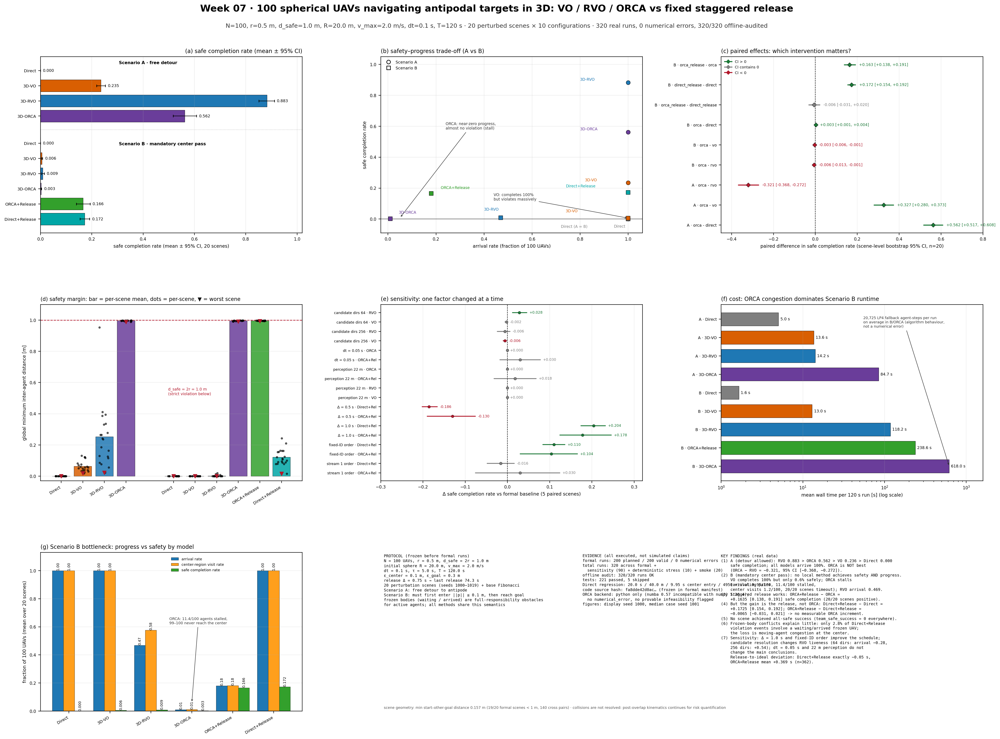

# Week 07 — 100 架无人机三维球面对跖点穿越：VO / RVO / ORCA 与固定分时放行对比

**任务**：按 `HANDOFF_UAV_ANTIPODAL_V2.md`（本目录本地输入规范，不随仓库提交）实现并实际运行一个可复现的
Python 项目，比较 100 架球形无人机（r=0.5 m，安全距离 d_safe=2r=1.0 m）在理想运动学条件下完成
**对跖点导航**时的三维 VO、RVO、ORCA，以及**固定分时放行**（ORCA + Staggered Release / Direct + Release 消融）。

> **提交到在线仓库的内容：本 README、[results_all.png](results_all.png) 与可复现代码**
> （`uav_orca_experiment/` 的 `uavbench/` 源码、`configs/`、`tests/`、项目 README/CONTRACTS/THIRD_PARTY_NOTICES、
> `pyproject.toml`、`requirements-lock.txt`，以及本目录的 `make_overview.py`）。
> 逐次运行数据（`results/`）、场景文件（`scenes/`）、全部图与日志（`reports/`）、虚拟环境与缓存
> 均为本地生成产物，已在仓库根 `.GITIGNORE` 中排除，可由 §5 的命令重新生成；
> 完整报告与报告用表是本地工作文档（同样不提交），本 README 即仓库内的结果汇总。
>
> 项目入口：[uav_orca_experiment/README.md](uav_orca_experiment/README.md) ·
> 总览图生成脚本：[make_overview.py](make_overview.py)（只读本地 `results/` 真实产物，无手写数值）
>
> 本 README 即结果汇总文档：核心结论、实验设计、全部主结果表、消融、敏感性、验证、复现命令与局限。



---

## 1. 核心问题与结论

**核心问题**：① 允许绕行时，三类局部避碰方法如何权衡安全、完成率与路程？② 当每架必须先进入
0.1 m 中心区域时，局部避碰能否同时维持安全与任务进展？③ 固定分时放行能改善多少安全完成率，
代价是什么，收益是否只来自降低同时在途数量？

| 结论 | 依据（本仓库真实运行） |
|---|---|
| **① A 场景（可绕行）四模型都 100% 到达，但安全完成率差异很大** | 20 场景安全完成率：**RVO 0.883 > ORCA 0.562 > VO 0.236 > Direct 0**；ORCA−RVO 配对差 **−0.321**（95% CI [−0.368, −0.272]，0/20 场景为正）。**ORCA 不是最优** |
| **② B 场景（强制过中心）局部避碰无法同时取得安全与进展** | VO 100% 完成但安全完成率仅 **0.6%**；ORCA 平均到达 **0.95/100**、中心访问 1.15/100、停滞 11.4 架/场景、**20/20 场景超时**，安全完成率 0.25%；RVO 到达 46.9%、安全完成率 0.9%。Direct 必然 4950 对全部侵犯 |
| **③ 固定分时放行显著改善 B 的安全完成率** | ORCA+Release − ORCA = **+0.1635**（95% CI [0.138, 0.191]，20/20 场景为正）；最后放行 74.3 s，全部到达 94.2 s（Direct+Release） |
| **④ 收益几乎全部来自“降低同时在途数量”，不是 ORCA** | Direct+Release − Direct = **+0.1725**（CI [0.154, 0.192]）；**ORCA+Release − Direct+Release = −0.0065（CI [−0.031, 0.021]）**，不能认为有差异；ORCA−Direct = +0.0025（CI [0.001, 0.0045]，效应量可忽略） |
| **⑤ 没有场景实现全队安全成功** | 全部 10 个（场景, 模型）配置的 `team_safe_success` 率均为 0：200 次正式运行中没有任何一次实现“100 架全部完成且全程零侵犯”；安全与活性必须分开讨论 |
| **⑥ 冻结体冲突存在但不是主要机制** | 19/20 个正式场景存在起点—他机终点交叉（min 0.233 m，合计 124 对）；但 Direct+Release 的 1414 个侵犯事件中只有 **39 个（2.8%）** 涉及等待/已到达冻结体（38 个涉及未释放者、1 个涉及已到达者），主要损失仍是运动机在中心汇聚 |
| **⑦ 敏感性显示结论方向稳健、量级依赖排程** | 放行间隔 Δ=1.0 s 明显优于 0.75 s（Direct+Release 安全完成 +0.204 [0.174, 0.232]），Δ=0.5 s 明显变差（−0.186）；fixed-ID 顺序 +0.110 [0.084, 0.136]，随机流 1 +0.030 [−0.076, 0.124]；候选分辨率显著影响 RVO 活性（64 方向到达率 −0.282，256 方向 +0.538），VO 到达率不变；dt=0.05 s 与 22 m 感知截断不改变主要解释 |

> 以上为**理想速度控制仿真**（瞬时速度、完美状态、无外部静态障碍）在 20 个扰动场景 + 1 个确定性场景上的结论；
> 不证明任意配置下的全局收敛或实机安全。失败、超时、停滞和间隔侵犯都如实保留在结果中。

---

## 2. 实验设计

### 2.1 两个场景与状态机

- **Scenario A（辅助）**：t=0 全部释放，目标是自己的对跖点（可绕开中心）；运行 M0—M3。
- **Scenario B（主实验）**：每架必须先进入 `||p|| ≤ 0.1 m` 中心闭球，再抵达 0.3 m 目标容差球；
  只要求先后访问、不要求同时到达中心；运行 M0—M4 及 C1 消融。
- 状态机 `WAITING → TO_CENTER → TO_GOAL → ARRIVED`（A 无前两阶段）；WAITING/ARRIVED 冻结、命令速度恒零，
  但**仍保留在邻居信息与全局安全检测中**。**冻结体语义**：活动机对等待/到达的冻结体承担全部避碰责任
  （ORCA α=1.0；VO/RVO 对冻结邻机使用 `w=c−0`），所有避碰方法共享同一语义。
- 唯一步进规则：同步快照 → 同一快照集中求解 → 每步命令在 `[t_k,t_{k+1}]` 恒定推进 → 用实际常速段做
  中心进入/到达检测 → `t_{k+1}` 切换阶段。禁止步内变速、瞬移、事后裁剪与位置吸附。

### 2.2 冻结参数

| 参数 | 值 | 参数 | 值 |
|---|---|---|---|
| N | 100 | 半径 r / d_safe / d_plan | 0.5 / 1.0 / 1.0 m |
| 初始球面 R | 20 m | v_max | 2.0 m/s |
| dt / τ / T | 0.1 s / 5.0 s / 120 s | 初始速度 | 全零 |
| 目标容差 ε_goal | 0.3 m | 中心容差 ε_center | 0.1 m |
| 邻居 | 全部 99 架（22 m 为敏感性） | 放行间隔 Δ | 0.75 s（量化后最后 74.3 s） |
| 正式场景 | 扰动种子 1000—1019 + 基础 Fibonacci | 随机重复 | 20 场景 × (4+6) = 200 次正式运行 |

**中心瓶颈几何**：两机中心同时在 0.1 m 球内时相距 ≤ 0.2 m < 1.0 m，因此无侵犯时该区域同时最多容纳 1 架；
两次首次进入至少间隔 `(1.0−0.2)/2.0 = 0.4 s`（必要条件，非充分条件）。由此得到的 59.35 s 只是几何下界，
实测最快全到达为 Direct+Release 的 94.2 s。

### 2.3 模型与实现要点

| ID | 方法 | 场景 | 实现要点 |
|---|---|---|---|
| M0 `direct` | 直接跟踪 v_pref | A、B | 解析校验与不避碰下限 |
| M1 `vo` | 有限时间 3D-VO + 确定性候选搜索 | A、B | 闭合线段 `[0,τ]` 球—线段解析判定；无 2D 投影 |
| M2 `rvo` | 3D-RVO（`2c−v_i−v_j`）+ 同一候选搜索 | A、B | 逐候选核对定义；冻结邻机等价于 VO |
| M3 `orca` | 3D-ORCA（RVO2-3D 忠实移植）+ 冻结球体适配 | A、B | α=0.5/1.0、官方 LP1–4、LP4 最小违反回退 |
| M4 `orca_release` | M3 + 固定分时放行 | B | 与 C1 共用完全相同的放行表 |
| C1 `direct_release` | M0 + 与 M4 相同放行表 | B | 必做消融 |

- 候选集：128 Fibonacci 方向（每场景一次固定整体旋转）× 速度层 {0.5,1.0,2.0} + 零/当前/v_pref，
  1e-9 去重，最多 387 个；搜索先测 v_pref，结果与暴力搜索逐位一致；无可接受候选时按“最大化全邻居最小
  TTC → 最小 v_pref 偏差 → 固定索引”确定性回退，并记录 `sample_exhausted`。
- ORCA 来源：[RVO2-3D](https://github.com/snape/RVO2-3D)（Apache-2.0，commit
  `f940bfba8bac9532ecae948f11639085e8cbf277`）；float64/稳定 ID/冻结 α=1 等适配与唯一一次精确预排序加速
  全部记录在 [THIRD_PARTY_NOTICES.md](uav_orca_experiment/THIRD_PARTY_NOTICES.md)。
  数值验证：随机可行实例半空间残差 1.22e-15 m/s，目标值与独立 SLSQP 差 1.68e-12。
- 分时放行用 `Decimal` 从绝对计划时刻向上量化到 0.1 s 网格（间隔 0.7/0.8 s），C1/M4 表逐位一致。

### 2.4 场景与随机流

- 基础场景：确定性 Fibonacci 球面（起点在 R=20 m 球面、目标严格取负）。
- 正式场景：切向高斯 + `θ~U(−2°,2°)` 角度扰动，起点/终点各自最小间距 ≥ d_safe，否则整体重采样
  （20 个正式场景重采样次数均为 0，最小起点间距 5.481 m）。
- 随机流分离：`scene_rng`（场景）、`schedule_rng` 流 0/1（放行）、`candidate_rng`（候选方向集旋转）；
  所有模型读取同一份 `scenes/scene_*.npz`（SHA-256 记录在 `scenes/manifest.json`）。
- 种子分离：开发 0—4；正式 1000—1019；敏感性 1000—1004；正式运行前冻结
  `results/formal/experiment_manifest.json`（200 条，源码 hash 一并写入）。

---

## 3. 结果

### 3.1 Scenario A（对跖点导航，辅助实验；20 场景）

| 模型 | 到达率 | 安全完成率 [95% CI] | 最小间距均值/最差 | 侵犯机对均值 | 平均路程 | 规划耗时均值 |
|---|---|---|---|---|---|---|
| Direct | 1.000 | 0.000 [0.000, 0.000] | 0.000 / 0.000 | 4950.0 | 39.80 m | 0.09 ms |
| 3D-VO | 1.000 | 0.236 [0.219, 0.253] | 0.064 / 0.019 | 218.3 | 42.08 m | 8.81 ms |
| 3D-RVO | 1.000 | **0.883** [0.851, 0.912] | 0.253 / 0.022 | 9.7 | 43.55 m | 10.42 ms |
| 3D-ORCA | 1.000 | 0.562 [0.517, 0.608] | 0.996 / 0.988 | 31.9 | 40.35 m | 69.45 ms |

### 3.2 Scenario B（必须先访问中心，主实验；20 场景）

| 模型 | 到达率 | 完成全部场景数 | 安全完成率 [95% CI] | 最小间距均值/最差 | 侵犯机对均值 | 全部到达时间 |
|---|---|---|---|---|---|---|
| Direct | 1.000 | 20/20 | 0.000 | 0.000 / 0.000 | 4950.0 | 19.9 s |
| 3D-VO | 1.000 | 20/20 | 0.006 [0.004, 0.009] | 0.000 / 0.000 | 1061.2 | 31.7 s |
| 3D-RVO | 0.469 | 1/20 | 0.009 [0.004, 0.015] | 0.002 / 0.000 | 115.4 | 105.2 s (n=1) |
| 3D-ORCA | **0.010** | 0/20 | 0.003 [0.001, 0.005] | 0.996 / 0.991 | 621.2 | null（超时） |
| ORCA+Release | 0.180 | 0/20 | 0.166 [0.140, 0.194] | 0.996 / 0.994 | 370.4 | null（超时） |
| Direct+Release | 1.000 | 20/20 | **0.173** [0.154, 0.192] | 0.121 / 0.016 | 70.7 | 94.2 s |

**解读**：B 中 ORCA 用停滞换取“几乎不侵犯”（最小间距 ≥0.991 m），VO 用大量侵犯换取完成，
RVO 介于两者之间；没有任何方法同时取得安全与任务进展。Direct+Release 的 94.2 s
= 最后放行 74.3 s + 19.9 s 行程，说明“分时放行”把系统从“同时挤过中心”变成“排队通过”。

### 3.3 调度与消融（场景级配对 bootstrap，20 对）

| 对比 | 指标 | 均值差 | 95% CI | 为正场景比例 |
|---|---|---|---|---|
| ORCA+Release − ORCA（M4−M3） | 安全完成率 | **+0.1635** | [0.1375, 0.1910] | 20/20 |
| Direct+Release − Direct（C1−M0） | 安全完成率 | **+0.1725** | [0.1540, 0.1915] | 20/20 |
| ORCA+Release − Direct+Release | 安全完成率 | −0.0065 | [−0.0310, 0.0205] | 4/20 |
| ORCA − Direct | 安全完成率 | +0.0025 | [0.0010, 0.0045] | 5/20 |
| ORCA − RVO（A 场景） | 安全完成率 | −0.3205 | [−0.3680, −0.2715] | 0/20 |

分时放行把 B 的安全完成率从约 0 提升到约 17%，方向稳定；但 **Direct+Release 几乎复现了全部收益**，
ORCA 在调度之上没有可测增量。另测“相对理想到心时刻偏差” `center_entry − (release_actual + R/v_max)`：
Direct+Release 恒为 −0.05 s（ε_center=0.1 m 的离散化几何），ORCA+Release 只统计到进入中心的 362 个样本，
均值 +0.369 s（p05/p95 = −0.05/+0.28 s）。

### 3.4 敏感性与确定性压力测试

固定种子 1000—1004，每次只改一个因素（基线复用正式结果，5 场景配对）：

| 因素 | 变体 | 关键结果（相对正式基线） |
|---|---|---|
| 候选分辨率（B, M1/M2） | 64 方向 | RVO 安全完成 +0.028 [0.012, 0.046]，到达率 −0.282；VO 到达率不变、侵犯事件 −242 |
| | 256 方向 | RVO 到达率 +0.538 [0.392, 0.672] 但侵犯事件 +213；VO 安全完成 −0.006 |
| 时间离散（B, M3/M4） | dt=0.05 s | ORCA 仍停滞；ORCA+Release 安全完成 +0.030 [−0.018, 0.078]（区间含 0） |
| 放行间隔（B, M4/C1） | Δ=0.5 s | Direct+Release 安全完成 **−0.186** [−0.202, −0.166]；ORCA+Release −0.130 |
| | Δ=1.0 s | Direct+Release **+0.204** [0.174, 0.232]；ORCA+Release +0.178 [0.124, 0.246] |
| 感知截断（B, M1—M4） | 22 m | ORCA/ORCA+Release 安全完成 0 / +0.018 [−0.032, 0.068]，基本不变；RVO 到达率 +0.12 [0.00, 0.36] |
| 放行顺序（B, M4/C1） | fixed-ID | Direct+Release +0.110 [0.084, 0.136]；ORCA+Release +0.104 [0.030, 0.166] |
| | 随机流 1 | Direct+Release −0.016 [−0.048, 0.016]；ORCA+Release +0.030 [−0.076, 0.124] |

**确定性压力测试**（未扰动 Fibonacci 基础场景，每配置 1 次）：A 场景 Direct/VO/RVO/ORCA 到达率均 1.00、
安全完成率 0.00/0.21/0.68/0.48；B 场景 ORCA 0 到达（625 侵犯机对，最小间距 0.994 m，timeout）、
ORCA+Release 0.15 到达/0.15 安全完成、Direct+Release 100% 到达且 0.15 安全完成。

---

## 4. 验证与可复现性

| 项目 | 结果 |
|---|---|
| 测试 | **221 passed, 5 skipped**（5 个 bench 需 `--bench`），日志本地生成于 `uav_orca_experiment/reports/logs/pytest_final.log` |
| Direct 精确端点回归 | A/B：20.0 s、40.0 m、首次中心进入 9.95 s、阶段切换 10.0 s、**4950 个侵犯机对**、d_min≈0 |
| Direct 默认任务回归 | A/B：19.9 s、39.8 m；B 首次中心进入 9.95 s、切换 10.0 s |
| 3D-ORCA 数值验证 | 半空间残差 1.22e-15 m/s；目标值与独立 SLSQP 差 1.68e-12；与官方标量移植差分 1e-9；`solver_infeasible=0`、`numerical_error=0` |
| 运行数 | 正式 200/200 有效、敏感性 90/90、压力 10/10、smoke 20/20；**0 次 numerical_error / 崩溃** |
| 离线审计 | **320/320 运行**：NPZ 重算指标与 `metrics.json` 逐字段一致；11 张 `comparison.csv` 每行可追溯到运行目录（明细本地生成于 `uav_orca_experiment/results/audit_report.csv`） |
| 代码版本 | 源码 hash `fa8dde42d0ac6e8881c0e0696e5f926020b85fb82cb69a4f6b528b5751ce3138`（冻结于正式 manifest） |
| 可复现性 | 场景/候选旋转/放行顺序独立随机流；所有模型共享同一场景文件；`--resume` 只复用“场景 hash + 配置 hash + 源码 hash + 后端”均匹配且审计完成的运行 |

---

## 5. 如何运行

```powershell
cd uav_orca_experiment
python -m venv .venv --system-site-packages
.\.venv\Scripts\Activate.ps1
python -m pip install -e ".[dev]" --no-build-isolation

python -m uavbench.cli validate-config --config configs/default.yaml
python -m uavbench.cli generate-scenes --profile full        # 21 个场景（base + 20 正式）
python -m uavbench.cli batch --profile smoke --jobs 20 --resume       # 20 次，成本估计（约 3 min）
python -m uavbench.cli batch --profile full --jobs 24 --resume        # 200 次正式（约 19 min）
python -m uavbench.cli batch --profile sensitivity --jobs 24 --resume # 90 次敏感性（约 15 min）
python -m uavbench.cli batch --profile stress --jobs 10 --resume      # 10 次确定性压力
python -m uavbench.cli summarize --results results
python -m uavbench.cli audit --results results                        # 320/320 应全部 ok
python -m uavbench.cli render-all --results results --out reports/figures
python reports/analyze_diagnostics.py                                # 冻结体冲突/瓶颈/到心偏差诊断
python reports/make_report_tables.py                                 # 报告用表（可选）
python -m pytest -o addopts=""
```

以上命令会在本地生成 `results/`（320 次运行）、`scenes/`、`reports/`（图、日志、审计明细），
**这些目录均已由仓库根 `.GITIGNORE` 排除，不提交**；克隆仓库后按本节命令即可完整重建。

重新生成本页总览图（依赖上一步生成的 `results/` 与 `reports/diagnostics.json`，约 10 s）：

```powershell
cd week07
python make_overview.py        # → results_all.png（同时生成矢量 pdf 仅本地保留，不提交）
```

单次调试运行：`python -m uavbench.cli run --model orca --scenario B --seed 1000`。

---

## 6. 目录结构

```text
week07/                                # 仓库提交：README.md + results_all.png + 可复现代码
├── README.md                          # 本文件（总览、结论、设计、复现）
├── make_overview.py                   # 生成 results_all.png（只读本地真实结果）
├── results_all.png                    # 一页总览图（提交）
├── HANDOFF_UAV_ANTIPODAL_V2.md        # 本轮实现规范（本地输入，不提交）
├── HANDOFF_UAV_ANTIPODAL_V2_CHANGELOG.md
├── outputs/researchwrite/…            # 上一轮设计阶段证据（本地，不提交）
└── uav_orca_experiment/               # 可运行项目；代码/配置/测试/文档提交
    ├── README.md                      # 项目手册（安装、CLI、结果摘要）
    ├── CONTRACTS.md                   # 内部接口契约（冻结）
    ├── THIRD_PARTY_NOTICES.md         # RVO2-3D 来源/commit/Apache-2.0/适配
    ├── pyproject.toml / requirements-lock.txt
    ├── configs/                       # default / full / smoke / development / sensitivity
    ├── uavbench/                      # 仿真器、规划器、指标、统计、审计、CLI、可视化
    │   └── planners/                  # direct / candidates / vo3d / rvo3d / orca3d
    ├── tests/                         # 221 个通过测试（覆盖 handoff §8 全部验收项）
    ├── scenes/                        # 本地生成，不提交（scene_*.npz + manifest.json）
    ├── results/                       # 本地生成，不提交（320 次运行，约 3.4 GB）
    │   ├── formal/                    # 200 次正式 + experiment_manifest.json
    │   ├── sensitivity_*/             # 5 个敏感性 block（90 次）
    │   ├── stress/                    # 确定性压力（10 次）
    │   └── smoke/                     # 成本估计（20 次，不冒充正式结果）
    └── reports/                       # 本地生成，不提交
        ├── experiment_report.md       # 完整实验报告（本地）
        ├── make_report_tables.py      # 对比表生成脚本（提交）
        ├── analyze_diagnostics.py     # 补充诊断脚本（提交）
        ├── tables.md / diagnostics.*  # 生成物（本地）
        ├── figures/                   # 9 类必做图 + 4 个 GIF（本地）
        └── logs/                      # pytest / batch / audit 日志（本地）
        └── logs/                      # pytest / batch / audit / 环境 / 代码 hash 日志
```

---

## 7. 局限与未执行项

- **理想速度控制**：瞬时改变速度，无加速度/姿态/传感/通信误差；结论不能直接外推到真实四旋翼。
- **完美状态**：所有算法共享同一精确快照；未测定位/通信延迟、噪声或部分可观测。
- **有限场景族**：20 个扰动场景 + 1 个确定性场景；不构成普遍规律。
- **静止终点策略**：到达后永久冻结，不考虑重新出动/回收/让位；已量化其冻结体冲突（2.8%）。
- **采样器质量**：VO/RVO 使用 128×3 层有限候选，64/256 敏感性显示 RVO 结果对分辨率敏感，
  其绝对水平不是连续速度空间的真最优。
- **后端性能**：ORCA 只有 python 后端（numba 0.57 与 numpy 1.26.4 不兼容且未安装）；
  B 场景 ORCA 耗时主要来自官方 LP4 回退（平均 20,725 回退机步/运行），是算法行为而非数值错误，
  不同实现/后端的速度差不能归因于算法理论复杂度。
- **碰撞后继续积分**：为量化 Direct 基线风险，重叠后继续运动学推进，不代表真实碰撞后仍可飞行；
  安全完成指标已剔除所有参与侵犯的无人机。
- **未执行（明确列出）**：N/R/τ/中心容差扫描、d_plan=1.05 m 裕量、动态中心预约、带加速度动力学、
  多因素全因子敏感性、C++/jit 后端对照、实机或高保真仿真验证。
- 20 个场景的统计结论按场景级配对 bootstrap 报告；未对所有次级比较做多重比较校正，相关 p 值（若引用）
  应视为探索性。

## 8. 第三方来源

- [RVO2-3D](https://github.com/snape/RVO2-3D)：commit `f940bfba8bac9532ecae948f11639085e8cbf277`，
  Apache-2.0；本项目移植 `Agent::computeNewVelocity` 与 `linearProgram1/2/3/4`，修改点、float64/稳定 ID/
  冻结 α=1 适配与性能预排序全部记录在 [THIRD_PARTY_NOTICES.md](uav_orca_experiment/THIRD_PARTY_NOTICES.md)。
- 相关文献/文档：van den Berg et al., *Reciprocal Velocity Obstacles for Real-Time Multi-Agent Navigation*,
  ICRA 2008；ORCA 作者项目页；RVO2-3D 官方文档与下载页（链接见 handoff §12）。
